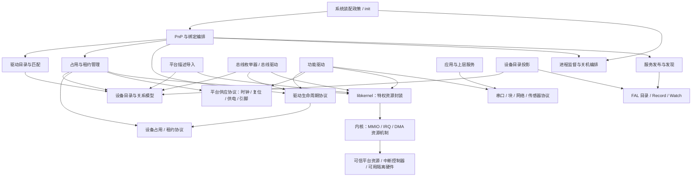
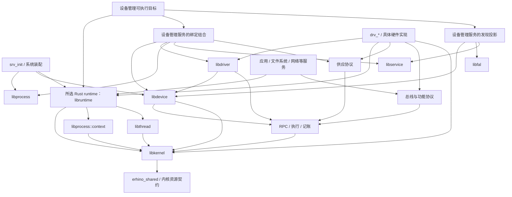
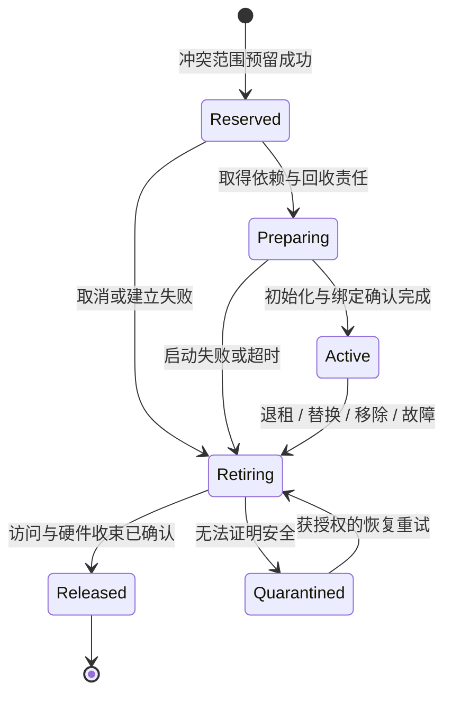

# 设备体系

设备体系把硬件事实、资源 authority、驱动占用和功能服务组合起来。内核强制特权资源的隔离与撤销；用户态描述设备、选择驱动、分配资源、维护设备生命周期并提供业务协议。驱动是取得特定资源的普通进程。

本篇描述目标模块与契约，不表示完整详细设计或设备能力已经完成。当前设计状态、未决项与施工前置见 [整体细化计划](../../plans/todo-2026-09-device-system-design.md)，初始概念与外部取证见 [概念稿档案](../../plans/archived/todo-2026-09-device-architecture.md)。系统定位与兼容边界见 [kernel](kernel.md)。

## 四个不同的对象

| 概念 | 回答的问题 | 拥有者与边界 |
|---|---|---|
| 设备描述 | 有什么设备、在哪里、需要什么、能提供什么？ | 用户态设备目录；描述不是 authority |
| 资源 capability | 能操作哪些 MMIO、IRQ、DMA 或父总线功能？ | 内核资源对象或用户态总线服务；操作权沿显式能力传播 |
| 设备占用与租约 | 谁正在驱动它，何时可以交给下一位？ | 用户态设备管理域；占用覆盖实际不能独立分配的资源 |
| 功能会话 | 应用可以使用驱动提供的哪些功能？ | 串口、块设备、网络、传感器等领域服务；不默认交付 raw hardware |

设备存在、驱动进程存活、服务 Ready 和设备可安全重新分配是不同事实。管理域分别依据其权威来源判断，不能用一个布尔值代替。

## 声明、发现与描述

### 三类声明

| 声明 | 内容 | 不能表达的权限 |
|---|---|---|
| 平台声明 | 可信 DT/板级事实、固定设备、保留区、地址与中断路由、固件占用和可交接范围 | 任意用户提交的同形数据不能产生物理 authority |
| 驱动声明 | 可支持的编程模型、总线/协议版本、资源需求、提供的协议、停机与恢复能力 | 匹配成功不授予访问权，驱动不能自行认证隔离或复位能力 |
| 系统装配声明 | 允许的驱动映像、固定绑定或自动匹配规则、必选设备、信任与预算、重启和共享政策 | 不得扩大平台实际支持的资源与隔离边界 |

平台事实的特权子集由可信启动路径验证并产生资源根。用户态可以解释完整设备描述、保留原始属性并投影到目录；描述中的资源引用必须关联已经存在的资源 authority，不能重新从物理数字铸造能力。内核不解释驱动名单和服务拓扑。

动态总线枚举器持有父总线的访问权与限定范围的子设备登记权。它发现设备后提交来源明确的描述；设备管理域只接纳该登记范围内的设备。新增 MMIO 或 DMA 访问只能从已授权的父窗口、requester 范围及平台资源派生，不能由子设备报告的地址或标识自动获得。能够配置地址窗口或 DMA 路由的枚举器属于相应硬件信任边界。

SPI/I²C 等设备可以由板级声明列举；可枚举总线可以运行期发现。逻辑设备或复合设备可以由已有功能组成，不要求每个设备都拥有自己的 MMIO、IRQ 或 DMA。

### 设备目录与身份

`libdevice` 拥有设备领域的身份、描述、关系、登记和占用语义；设备管理服务持有每个受托范围的唯一可写目录。描述包含来源、编程模型、可见属性、资源引用、父子关系、供应依赖、分配约束和平台确认的恢复能力。通用描述只规定这些语义边界，具体寄存器和总线属性由相应领域解释。

位置、名称、固件路径和序列号是选择或诊断信息，不作为 authority。一次插入/登记产生新的设备实例身份；驱动绑定另有代次。拔出后在同一位置出现的设备不能继承旧租约，旧驱动的 Ready、完成和清理不能修改新绑定。

描述变化以版本化完整快照发布。Watch 只提示重读；读者先订阅再枚举，处理版本冲突与实例替换，不要求可靠保存每个插拔边沿。描述来源失效时，其依赖实例失去可信存在依据并停止新的准入。

## 三种关系与分配粒度

设备体系维护不同含义的关系，而不是把所有关系塞进一棵设备树：

- **拓扑关系**：控制器、总线、端口与子设备的连接；用于枚举、位置和移除传播。
- **供应依赖**：时钟、复位、供电、引脚、父总线会话以及其他功能；用于准备、就绪和停止排序。必需启动依赖必须可排序，无法打破的循环使配置失败。
- **隔离与恢复约束**：哪些功能共享 MMIO 页、中断来源、DMA 隔离边界、复位域或电源域；用于决定是否能分别交给不同 owner，以及恢复会影响谁。

独占分配单位必须覆盖实际不可隔离的资源；恢复操作另外计算受影响集合。共享一个复位域不必永久合并所有业务会话，但任何一方不得未经协调复位其他仍在工作的成员。缺少硬件依据时保守合并或拒绝独立分配。

设备编号不同不证明可独立租借。共享寄存器页不能靠不同字节范围的描述实现页级隔离；共享 IRQ 不能让多个驱动分别拥有同一控制器来源的 mask/ack 权；无独立 DMA 隔离的功能不能按软件名字声称相互隔离。

复合设备声明必需的功能集合，只有成员、资源和供应依赖全部满足后才发布组合服务；准备失败返还预留，成员失效按组合契约撤出。模块支持这种组合，不要求首批设备实现复合匹配引擎。

## 逻辑模块

逻辑模块是知识和状态的边界，不要求每项各建一个进程或 crate。

| 模块 | 唯一职责 | 主要使用的能力 |
|---|---|---|
| 平台描述导入 | 将可信声明关联到平台资源，保留来源、范围与保留状态 | 启动描述、资源根 |
| 总线枚举与访问 | 发现子设备、管理总线地址和事务、报告移除 | 父总线资源或会话、限定登记权 |
| 设备目录 | 设备实例、描述快照、关系与存在性 | 描述导入、受权登记 |
| 驱动目录与匹配 | 解释驱动声明，产生候选和未匹配原因 | 设备快照、系统允许的驱动集合 |
| 占用与租约管理 | 对冲突范围独占预留，交付使用权并持有回收责任 | 设备目录、资源控制权、供应服务 |
| PnP 与绑定编排 | 将发现/失效事件转化为准备、启动、停止或恢复 | 匹配、租约、驱动生命周期、进程监督 |
| 驱动运行支持 | 准备、初始化、Ready、停止、排空、退出；有界处理 IRQ/I/O | 设备租约、Runtime、资源封装 |
| 平台供应服务 | 时钟、复位、引脚、供电等共享资源的受权操作与仲裁 | 自身控制资源、消费者会话 |
| 功能协议 | 串口、块 I/O、网络、传感器等具体能力及共享政策 | 驱动或父功能服务 |
| 发现投影 | 设备描述与管理视图、已 Ready 功能的服务发现 | 设备目录、FAL、服务 Registry |
| 根监督与系统收束 | 管理服务死亡后的兜底、关机的停止顺序与升级 | Job/Process control、保留的资源控制 authority |

### 模块依赖图

箭头 `A → B` 表示 A 使用 B 的知识或接口。图不表示数据流、启动先后或一对一进程划分；事件回报通过下层定义的协议完成，不形成反向知识依赖。

图中的供应和功能节点是协议，实际 provider 为持有对应能力的普通服务或驱动；调用协议不依赖某个具体 provider。图省略各模块共同依赖的 RPC、执行、记账和 IPC。

### 库与进程装配

- `libdevice`：设备描述、受权登记、关系、占用、租约与管理协议。既有管理侧也有消费侧，不依赖 `libdriver`、具体驱动或具体总线实现。
- `libdriver`：消费 `libdevice` 的租约与依赖，拥有驱动生命周期协议和可复用运行支持；组合 `libkernel`、公共执行和记账。具体设备类别的业务协议不集中进一个万能驱动接口。
- 总线与功能协议：各自拥有事务、地址、数据格式和领域错误；驱动实现协议，上层只依赖协议。具体公共库在真实领域边界明确后命名。
- 设备管理进程：组合设备目录、租约、匹配/PnP、驱动生命周期客户端、进程监督和发现投影。初期可在一个管理域内承载这些模块，后续按信任、故障或资源边界拆分。
- 驱动进程：组合生命周期支持、具体硬件实现和功能协议；一个进程可承担多个角色，但必须显式表达隔离和共同故障范围。

FAL 不定义设备 schema，Registry 不拥有设备占用表，通用 Runtime 不解释 IRQ 业务。模块实现须遵守 [库知识归属](../../user/libraries/README.md)。

驱动知识也可被设备管理、诊断或其他普通进程复用。库的链接关系不授予设备 authority；进程持有实际设备资源并提供功能 endpoint，才承担对应驱动角色，发布到服务目录则形成可发现的服务。具体 Rust runtime 仅由可执行目标选择，`libdevice`、`libdriver` 及其他公共库通过 `libkernel` 使用内核契约；运行时分层由 [framework](framework.md) 唯一规定，图中的目标分层尚待 [迁移计划](../../plans/todo-2026-09-runtime-kernel-library-separation.md) 实现。

### 在全系统中的组织

设备体系同时遵守三种划分：领域模块拥有知识，运行进程形成信任与故障边界，具体实例持有状态和 authority。一个库可以在不同进程中使用，一个进程也可以组合多个领域 owner；同进程不把多个领域状态合成一笔隐含事务。

| 系统层次 | 模块组织 | 不承担的职责 |
|---|---|---|
| 应用与功能层 | 应用、文件系统、网络与控制业务消费领域协议；上层可再提供组合功能 | 不经设备目录绕过驱动直接操作硬件 |
| 系统装配层 | init 与受托编排者持系统配置、启动组、管理域、预算配置和故障升级政策 | 不复制设备占用账本，不解释具体硬件停机序列 |
| 设备管理层 | 设备目录与租约 owner；绑定协调者组合驱动声明、匹配、生命周期、进程监督和服务发布 | 不处理每笔业务 I/O，不替功能服务仲裁普通客户端会话 |
| 驱动与供应层 | 总线、功能、时钟、复位、引脚和供电 provider；各自持协议、在途操作与硬件状态 | 不自行扩大资源 authority，不替管理者宣布租约整体释放 |
| 公共能力层 | RPC、执行、记账、进程、服务发现、FAL、流与记录队列按原领域复用 | 不枚举设备类别或解释设备恢复政策 |
| 资源机制层 | libkernel 安全 owner、共享 ABI、内核 MMIO/IRQ/DMA 与平台后端 | 不解释驱动名单、设备名字、PnP 或应用会话 |

这些层次用于划清责任，不要求邻层逐一转发所有调用。功能协议可以直接使用 IPC，驱动可以直接操作其 MMIO，编排者可以直接使用进程能力。数据面不绕行设备管理者。

### 模块内部的知识归属

下表确定逻辑组织；列出的子模块职责不冻结 Rust 路径或 ABI 布局。

| 拥有领域 | 内部职责划分 | 对外契约与依赖约束 |
|---|---|---|
| `libdevice` | 设备身份与描述、关系模型、受权登记、快照观察、冲突范围与占用、租约管理与查询 | 基础契约供登记者、管理者和使用者共同使用；不解释驱动声明、映像来源或 Registry 状态 |
| `libdriver` | 驱动声明、匹配谓词与需求表达、初始化/静默/停机协议、驱动侧生命周期推进 | 使用 `libdevice` 表达需要的设备与租约；候选匹配是依据声明的机制，选哪个候选及何时重启由编排政策决定 |
| 设备绑定组合 | 驱动目录、候选选择、资源准备、启动交付、Ready 核验、发布/撤出、停止协调和故障升级 | 同时消费设备、驱动、进程、服务与公共能力；初始属于设备管理服务的内部组合模块，不放回 `libdevice` 形成反向依赖 |
| 平台导入与总线枚举 | 平台事实关联、地址/中断转换、子设备描述、受限资源引用 | 通用格式解析归格式领域，平台和总线解释归各自模块；内核与用户态不能各维护一套互相矛盾的物理布局 |
| 总线协议 | 事务目标、传输配置、排队、取消和总线恢复影响 | 传感器等子驱动依赖总线协议，不依赖某个控制器驱动实现 |
| 功能协议 | 串口、块、网络、传感器或执行器各自的请求、会话、错误、数据交接和完成语义 | 应用与 provider 共用协议；不要求应用链接驱动管理机制 |
| 平台供应协议 | 资源需求、兼容性约束、取得/变更/释放和受影响集合 | 时钟、复位、引脚、供电是不同领域；不强制合并成一个电源管理服务或万能资源协议 |
| 发现与诊断组合 | 设备目录的 FAL 投影、服务记录关联、未匹配/冲突/隔离原因查询 | 由投影模块使用 `libdevice`、FAL 与服务接口；不在下层增加设备专用枚举 |
| 特权资源机制 | 范围与派生、控制/使用分离、mapping/binding、观察、撤销和完成证明 | libkernel 表达本地持有与显式完成，内核拥有已提交特权维护；跨资源协调继续在设备管理域 |

`libdriver` 的驱动停机契约表达设备初始化、停止提交、在途 I/O 排空和硬件静默。进程执行/Drain 仍归 `libprocess`，服务注册可见性仍归 `libservice`，任务调度仍归 `libexecution`。绑定协调者汇合这些独立事实，不能用一个共享 Start/Stop 状态机抹平差异。

下面进一步表示代码组织的依赖骨架，节点中的候选服务名不冻结进程划分；公共依赖按领域合并展示，不表示新增聚合库。libprocess 的管理组合与基础 context 属同一 crate 的不同功能集；runtime 只消费 context。它可以组合 libthread，但这些库不反向依赖 runtime。

### 状态、命令与完成事实

每项实际状态都由一个实例拥有；观察者可以保存带身份和代次的快照，但不能据此成为第二个写入者。

| 事实 | 唯一写入者 | 谁可据此做什么 |
|---|---|---|
| 平台可授资源、保留区与可派生范围 | 可信资源机制；平台管理者只能在授予范围内派生 | 目录把描述关联到资源，租约管理验证取得范围 |
| 设备实例与描述版本 | 所属设备目录 owner，接受范围内受权登记 | 匹配与查询消费快照；来源消失阻止新的绑定 |
| 驱动映像与声明的关联 | 受信驱动目录管理者 | 匹配只对经配置接纳的映像和声明生效；设备属性不能选择任意可执行文件 |
| 期望绑定与恢复意图 | 所属绑定协调者 | 请求占用、启动与停止，不直接改底层资源状态 |
| 预留、租约代次、退休与隔离 | 所属设备占用 owner | 决定冲突、封闭使用及何时允许重新分配 |
| 供应约束与有效供给 | 相应时钟/复位/引脚/供电 owner | 客户端请求需求，provider 仲裁兼容性和影响范围 |
| 驱动准备与设备侧在途操作 | 驱动运行 owner | 报告初始化/排空进度；报告的可信程度受驱动信任配置约束 |
| 进程存活与回收 | 内核进程对象自动回收；用户态监督者决定政策并观察 | 协调者处理驱动退出，不能据此推断硬件已经安全 |
| 服务注册与发现可见性 | Registry 注册 owner | 发布者变更注册；调用者不能据可见性推断设备健康 |
| 功能 session 与业务请求 | 功能 provider | 接受/取消/完成业务；设备管理不逐请求复制账本 |
| MMIO/IRQ/DMA 绑定与特权撤销进度 | 相应内核资源对象 | 用户态等待完成；设备安全还需设备/总线事实 |
| 系统是否接受新工作与最终终局政策 | root supervisor 或明确受托的系统编排者 | 按依赖收束，并在满足政策后提交 SystemReset |

管理 authority、执行恢复所需 authority 和付款来源分别交付。管理者可要求驱动停止，不代表它自己能复位硬件；持普通 MemoryPool 不代表能撤回已经分配给设备的 backing。

### 进程装配与控制面、数据面

目标运行角色包含 init、设备管理域、驱动域、供应 provider 和功能消费者。设备管理域可由未来 `srv_device` 承载，但进程数量、是否分域及供应服务位置需由授权和故障设计确定，不从模块数量推导。

init 将设备资源控制范围、受托 Job、付款来源、允许的驱动映像来源和初始依赖交付设备管理域；上级保留其声明承担的收束 authority。受托绑定协调者可使用 `libprocess` 在明确的 Job 范围内创建驱动；配置若集中创建 authority，则通过受权启动协议交付同样的构造与监督责任。选择必须在运行拓扑设计中唯一确定，不能给两方不一致的进程账本。

驱动间的数据路径是应用 → 功能服务 → 父总线或设备队列 → 硬件。RPC 负责控制请求，Runnel 负责字节流，BufferQueue 负责记录与缓冲交接；具体领域决定采用哪些运输。软件完成、设备执行完成、DMA 可回收及持久化完成各按领域定义，不能复用一个没有限定含义的 completion。

管理控制面负责绑定与资源变化，不串行转发正常 I/O。监督与恢复所需的执行容量、内存和入口不能全部依赖已经拥塞或故障的业务路径；具体预备资源与计费方案须在资源设计中确定。

### 跨领域契约接点

- 启动装配：三类声明如何关联可信映像、平台资源与 Building grants，由 [bootstrap](bootstrap.md) 的通用装载契约与本篇设备语义共同组成；设备领域不另建 launcher。
- 内存与 DMA：普通 MemoryPool grant 的不可撤销语义保持由 [mm](mm.md) 拥有；可召回保留区与 DMA 保活必须显式连接平台 region、借用 owner 和资源退休，不能借租约名义改变普通 Pool 契约。
- 注册与功能可用性：绑定协调者串联设备 Active、驱动入口准入和 [服务注册](service.md)，分别处理部分成功；Registry 不替硬件恢复作证明。
- 系统收束：业务停止、缓冲归还、设备停止、进程回收与供应释放以依赖和完成条件排序；整机关机政策与设备局部恢复分别拥有自己的决策，不推导出独立电源管理进程。
- IRQ 与执行：IRQ 来源接入 [等待](wait.md) 和 [执行](framework.md) 的既有 owner 模型；中断代次、重武装、退出后观察撤销、跨 hart 路由和风暴准入须联合设计。
- 预算与公平：设备独占范围、页额度、metadata、在途请求、IRQ 工作量与用户态执行是不同约束；按各自 owner 计费、背压和调度，不能以一个设备配额替代。

### 设计成熟度与施工入口

本篇当前确定领域划分、依赖方向和关键不变量。模块组织不等于接口闭合：身份空间与管理域、授权派生与撤销、跨域准备协议、恢复证明、平台供应仲裁、DMA/保留内存、IRQ 并发及运行拓扑仍须逐层细化。

详细设计覆盖静态绑定、共享总线、动态枚举、复合依赖、DMA 与恢复、系统收束等结构不同的场景，再确定具体平台与首批能力。实现可按依赖有先后，设计不能仅围绕一个容易运行的设备缩小架构。当前细化顺序、未决问题与进入施工的条件见 [整体细化计划](../../plans/todo-2026-09-device-system-design.md)。

## PnP 是编排政策

PnP 使用一条统一流程：接纳设备描述 → 解析依赖 → 选择允许的驱动 → 预留占用 → 准备资源 → 启动并初始化 → 发布功能。自动匹配只产生候选，最终绑定还要通过政策、资源冲突和供应依赖检查。

PnP 拥有期望绑定和自动恢复政策，占用/租约管理拥有实际预留、使用与退休状态；PnP 经管理协议推进和观察，不复制第二份可写占用表。应用、显式管理员与 PnP 的申请经过同一准入门。

静态嵌入式配置可以直接指定设备—驱动绑定，复用同一占用与生命周期而不运行自动匹配。固定设备也需要初始化失败、驱动崩溃和恢复处理；物理热插拔只是设备存在性变化的一种来源。

驱动探测可能读写硬件，只能在取得排他预留及明确的探测授权后执行。不能为了匹配同时让多个候选驱动访问设备。必选设备无法匹配或准备时使所属启动组失败；可选设备形成明确的未绑定或降级状态。

## 接管、租借与共享

**接管**是一个驱动成为某个设备功能或分配范围的操作者。管理者先持有完整回收权，驱动只取得本次绑定所需使用权。首次绑定、替换驱动和驱动重启都经过同一准入门；普通申请不能抢占仍有效的租约。强制替换需要独立管理 authority，并先收束旧绑定。

**租借**是带有限范围、可结束生命周期和回收责任的使用授权，不强制周期续租或墙钟 TTL。到期只启动收回，不表示 DMA 已停或资源已退款。租约协议位于用户态，内核只提供各底层资源的撤销与完成事实。

租约管理至少表达以下不同方式：

| 方式 | 交付内容 | 收束责任 |
|---|---|---|
| 驱动独占资源 | MMIO/IRQ/DMA 使用能力与供应会话 | 设备管理者协调底层撤销、硬件停止与恢复 |
| 子设备/总线会话 | 如特定片选、地址或功能范围内的事务 endpoint | 父总线 owner 仲裁在途事务、取消、复位影响和 session 退出 |
| 应用功能会话 | 如串口流、块设备范围或传感器订阅 | 功能 provider 决定共享、配额、请求完成与关闭 |

I²C 传感器驱动通常只需要父总线会话；控制器驱动持寄存器、中断和 DMA。应用通常只需要传感器协议。不能把“租借设备”统一解释为向所有层发放 raw MMIO。

### 接管和发布

1. 管理者以设备实例及绑定代次预留全部冲突范围；同一管理域内整体预留的提交是竞争接管的唯一胜负点。跨管理域组合必须采用确定的取得顺序或失败即返还的预留协议，不能各持一部分资源无限等待；所有成员准备成功前不激活组合设备。
2. 准备恢复责任、付款来源、供应会话、资源控制能力及进程监督槽。建立期资源由管理者持有，即使申请方消散也有 owner。
3. 在驱动 Building 期交付本次使用能力和依赖，经普通 ProcessStart 启动。多类资源的准备由用户态事务组合，不要求内核提供一次性 DeviceCreate。
4. 驱动在本次授权内初始化并报告 Ready；管理者核对实例、代次和必需依赖，再允许按出口政策发布功能服务。
5. 发布前失败不得暴露半就绪功能。尚未触碰硬件的准备可直接释放；已经启动或改变硬件的失败进入停止与恢复，不能假装回到从未使用的状态。

设备 Active 与 Registry Ready 由各自 owner 持有，不要求跨服务原子提交。先使设备可服务，再发布 endpoint；发布结果未知时保留注册控制和租约，查询或撤出原实例，不重复绑定。停止先关闭新业务准入并撤出发现，已有能力按协议失效与收束；摘名本身不撤销设备访问。

## 退租、移除与故障

每个绑定有独立生命周期；旧绑定终态后若设备仍存在且已安全回收，可以创建新绑定。

`Released` 只表明该绑定不再占用资源，设备存在性另行判断。`Quarantined` 保留冲突范围、可能仍在被访问的内存和未兑现的责任；超时、驱动死亡或进程资源收束完成不能把它自动变为 Released。

### 正常停止

先阻止新功能会话和设备绑定，再通知驱动停止新 I/O、完成或取消在途请求。设备侧停机、控制器侧 IRQ 屏蔽/完成、DMA 同步与解除映射、MMIO 撤销必须遵守该硬件的依赖顺序；供应资源在其消费者安全退出后才释放。部分设备停止需要 IRQ 完成，不能规定所有设备都在排空前屏蔽全部中断。

租约管理者最后汇合底层资源的完成事实、硬件安全状态及依赖释放结果，才解除占用。回复丢失不释放 owner，已接受的退租由管理者继续推进，调用者可以查询同一操作。

### 驱动崩溃与突然移除

故障入口立即关闭新的准入并启动不依赖故障驱动的回收路径。根资源控制者撤销旧使用授权、停止旧 CPU 访问，并通过可信控制器或恢复 provider 停止/隔离 DMA 和处理中断。具体先后由设备约束决定；隔离失败的设备与 backing 留在隔离状态。

突然拔出不能依赖设备响应正常停止命令；父总线必须提供相应访问失败、隔离与移除事实。平台若不能安全容忍某设备的消失，就不能宣称支持该设备的突然移除。对机械危险或其他外部作用的“安全状态”必须由领域定义，撤销 MMIO 不证明执行器已经停止。

驱动进程退出不代表总线事务或 DMA 结束。DMA backing 的保活不依赖驱动地址空间或普通 Handle；它必须持续到可信完成/隔离与同步屏障成立后才返回来源账户。进程管理收束与硬件收束分别记账。

### 管理者失效与固件交接

资源管理域的上级保留覆盖受托范围的资源控制 authority 和驱动管理能力。管理服务死亡时，上级可以封闭整域、终止受管驱动并调用底层撤销；丢失用户态恢复进度时进入保守隔离与重新确认流程，不透明重建旧租约。不提供上级接管的配置必须明确该管理域为不可恢复的信任根。

固件或内核仍在使用的设备不能作为普通可用设备发布。接管需要原 owner 明确交接且满足平台协议；例如某串口仍由固件调试输出使用时，不能仅凭匹配到串口节点把同一硬件交给用户驱动。内核时间、根中断控制器和隔离控制硬件同样不能被普通驱动映射为可任意写的设备。

## 内核需要提供的机制

设备模型和 PnP 均在用户态；下列机制用于让授权、撤销和隔离具有实际效力。名字表达概念，不冻结 ObjectKind、调用号或结构布局。

| 机制 | 内核承诺 | 留给用户态的工作 |
|---|---|---|
| 平台资源根与受限派生 | 只从可信物理事实或已有资源窗口派生能力，拒绝越界与不允许的重叠 | 设备命名、匹配、用途选择和授予政策 |
| MMIO 资源与使用绑定 | 范围、映射属性、访问权限、使用代次、派生副本/映射的统一撤销及跨 hart 完成 | 寄存器协议、设备初始化和正常停机 |
| IRQ 来源与绑定 | 受权路由、屏蔽、pending 观察、确认/重新武装、解绑和迟到事件隔离 | 设备状态处理、共享线仲裁、异常恢复政策 |
| DMA 地址域与映射 | backing 保活、设备地址与方向限制、可用隔离硬件配置、必要的同步及撤销完成 | 描述符、队列、请求协议、设备排空与复位政策 |
| 控制者与使用者分离 | 上级控制 authority 可封闭受托使用范围，旧副本不能绕过已撤销绑定 | 跨资源协调、租约期限、重试和重新分配 |

关闭某个 Handle 只移除一个引用，不能冒充撤销全部 MMIO 映射或副本。底层使用绑定必须有共享的有效性与撤销状态；已提交的特权撤销由稳定内核 owner 按预算推进，驱动和管理调用线程消散都不能丢失该责任。跨资源的设备恢复则继续由用户态管理者持有。

设备控制寄存器可能无需 CPU 特权指令，但影响全局隔离的寄存器仍属于受保护机制。根中断控制器和 IOMMU 的安全关键配置由内核后端控制；设备自身队列、协议寄存器及普通供应控制可在用户态。具体平台实现须证明该划分，不能仅以“可以映射”判断能否委派。

### IRQ 的目标形态

IRQ binding 直接接入现有可等待对象体系，由 WaitMany/WaitSet 观察 pending/关闭，驱动使用自己的线程和栈处理设备。内核硬中断入口只完成有界控制器动作和状态发布，不调用用户 handler，也不做无限设备排空。

同一硬件来源只有一个控制器层 owner。默认按一次处理周期持有 pending，并在必要时屏蔽来源；驱动处理设备状态后，凭当前绑定确认并请求重新武装。pending 是工作提示，不保证边沿次数；完成必须按控制器与设备的真实协议判断。迟到确认不能解除新绑定的屏蔽，解绑先停止交付再处理已有控制器状态。

共享 IRQ 交给一个有 authority 的仲裁者，或将相关设备置于同一控制范围，再分发逻辑事件；不允许多个独立驱动直接操作同一来源。需要额外服务的级联控制器可以在用户态，但其上游来源仍须有界屏蔽与唤醒。中断风暴保留可观测的屏蔽/故障状态，不以无界重试占满内核。

PLIC、AIA、MSI 或 GPIO 级联的具体 ack/mask 顺序需要各自固定规范，不能把上述目标形态当成已经确定的寄存器流程。

### DMA 的硬边界

MemoryObject 提供内存 backing，DMA 映射在其上建立独立的设备可访问寿命。Runnel/BufferQueue 表达软件交接，不自动 pin 内存、不建立 IOMMU 隔离，也不证明设备已经停止。DMA 地址、CPU 地址和物理地址不能相互冒充。

有可用隔离硬件时，映射只授权指定设备地址域访问指定 backing；撤销完成必须包含该平台要求的翻译失效、在途访问和缓存同步边界。单纯删表项、关闭能力或收到一次 IRQ 都不足以证明可以复用内存。

没有 IOMMU 或等价硬件限制时，可任意编程 DMA 地址的驱动属于扩大后的信任边界；范围描述和 DMA window capability 不能阻止它写出窗外。该配置只能接纳明确受信的驱动，或由可信代理控制设备。bounce buffer 可以解决地址范围或软件数据交接问题，不能单独提供恶意 DMA 隔离。停止或复位也不能确认时保留相关 backing，必要时升级为平台级恢复。

## 描述与服务发现的组合

设备目录可按授权投影到 `/System/Devices`，用于查看存在性、属性、依赖、绑定、隔离原因和管理入口；功能 endpoint 通过现有服务 Registry 发布。路径只是默认 namespace 政策。

设备记录是设备领域状态的只读投影；服务记录是 Registry 的发布状态。两者用实例与绑定代次关联，不能互相复制一份可写生命周期。描述可见不代表允许接管，服务可见不代表客户端取得 raw resource。

控制操作经过独立管理 endpoint 的授权检查，不通过任意修改 FAL 属性、删除目录或 Take 一枚资源能力绕过租约。功能会话按其领域协议建立；撤出目录不追溯销毁已经授出的 endpoint。

启动关键依赖通过 Building grants 直接交付；目录服务 Ready 后再开放动态发现。设备管理、首个总线驱动和首个目录服务之间不能形成“必须先发现对方才能启动”的环。

## 接入与完成边界

第一条设备链需要共同接通：平台资源与保留区 → 描述/绑定政策 → 使用授权 → 驱动初始化 → 功能消费者 → 正常停止与失败回收。只有模块或 syscall 存在不能算设备接入完成。

正式完成至少证明：越权操作拒绝、竞争接管唯一获胜、建立失败保全责任、旧绑定不能影响新绑定、驱动退出后资源正确收束、无法安全回收时保持隔离。涉及 DMA、共享资源或热插拔时增加相应的硬件与组合证据；不支持的能力明确拒绝。

整体设计覆盖静态绑定、自动匹配、动态枚举、复合依赖、DMA 与恢复等结构差异，再确定首批实现能力和依赖顺序。后续扩展同步资源生命周期与实际消费者，不能以通用模型已经存在宣称这些能力已交付。
