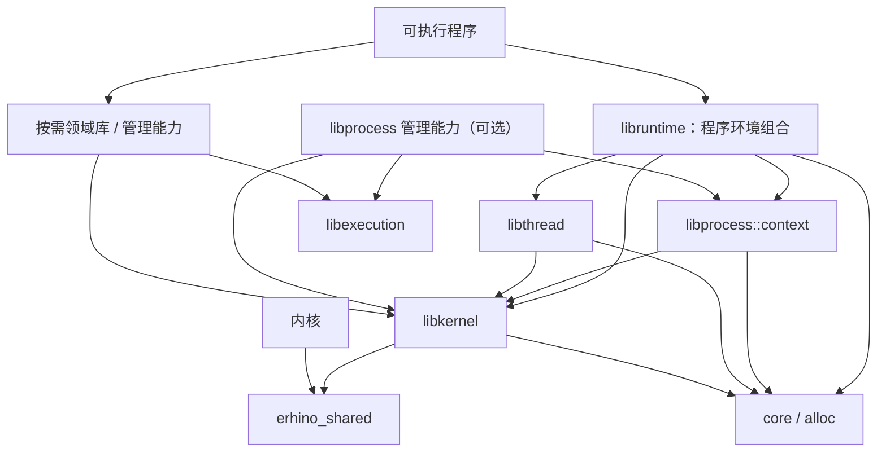

# 用户态库与服务框架

用户态库按领域集中概念与契约，通过单向依赖组合能力。库提供知识与实现，capability 决定操作权限，进程的运行角色由所选框架、领域能力和授权共同构成。管理与消费可以共享同一领域库；普通进程使用进程管理领域的类型或查询接口，不因此承担服务角色。装载链由 [bootstrap](bootstrap.md) 拥有，本篇拥有运行期库的分工。

下层提供通用概念，上层解释自身领域。服务框架可以用 FAL Record 表达服务记录，FAL 不预定义服务记录或服务资源分类；RPC、路径访问、流和进程能力不依赖服务框架。通用记账由专门的知识库拥有账户、额度、预留与退款，通用执行拥有任务推进、观察与期限；领域政策分别消费它们，不能因首个消费者是服务而将公共机制归给服务领域。

## 内核契约、领域库与可替换运行时

用户态公共库与具体 Rust runtime 解耦。`libkernel` 拥有 eRhino 的用户态内核调用和安全资源契约；`libruntime` 是放在 `user/libraries/`、由可执行二进制选择的一种 Rust runtime。库不通过依赖 runtime 取得 syscall、Handle、内存或等待知识。当前实现尚未按此分层，实际职责见 [framework impl](../impls/framework.md)，迁移范围与未决接口见 [运行时分层计划](../../plans/todo-2026-09-runtime-kernel-library-separation.md)。

### 知识 owner 与组合关系

`libruntime` 可以依赖其它知识库；禁止的是通用知识库反过来依赖具体 runtime。依赖依据是程序环境实际需要完成的职责，不是“凡进程可能用到的东西都放进 runtime”。runtime 使用 Process/Thread/IPC 的知识，不因此成为这些知识的拥有者。

默认 Rust 程序环境组合当前进程上下文、首执行线程环境、后续线程的环境工厂、allocator、异常与退出政策。消息与 Notification API 由 libkernel 供所有程序使用；API 可用不意味着 runtime 创建缺省邮箱、额外线程或消费通知。空程序只初始化自身必要状态，不启动服务发现、RPC 或后台 dispatcher。

| 组件 | 知识与状态归属 | runtime 的使用边界 |
|---|---|---|
| `shared/erhino_shared` | 内核/用户共用 ABI、固定宽调用号、Handle/rights、Pid/Tid、结果布局与校验 | 不拥有用户侧调用代码、Rust 返回值政策或语言入口 |
| `libkernel` | ecall、错误解码、内核资源 safe owner、映射、时间、Wait、Mailbox、Notification 等原语 | runtime 的低层依赖；不会自动取得 capability，不依赖上层执行或领域库 |
| `libprocess` | 当前进程身份/启动上下文，以及独立的 Job/Process 构造、装载与监督组合 | runtime 消费上下文模块；不自动执行创建、管理或监督操作 |
| `libthread` | 本进程线程的环境契约、栈、准备/发布、ThreadRegistry/ThreadRecord、结果和 cleanup step | runtime 提供语言环境实现；其它消费者也可直接组合这套线程机制 |
| `libruntime` | Rust `_start` 入口、allocator、panic/OOM/入口错误政策、ThreadRegistry 实例与线程环境实现 | 组合上述库；不复制 Process/Thread 类型、关闭账本或线程状态机 |
| `libexecution` / `librpc` | 事件任务推进 / 请求应答协议 | 按用途选择，不是普通程序语言启动的必经路径 |

libkernel 是 user workspace 的公共库，不因共享使用进入 shared workspace。它的 raw/safe 边界、值/borrow/owner、转换/失败返还及分配/停驻分类由 [用户态内核接口](kernel-interface.md) 唯一规定；本篇只拥有这些接口如何被上层组合。

Pid/Tid 的固定宽表示来自 shared，当前进程视图和 Process 的领域操作来自 libprocess；只为了读取 PID 不需要持有 ProcessControl，也不应从 runtime facade 获取第二个 PID 类型。启动块中的身份是启动方提供的 provenance，不因外层格式校验就变成内核认证；IPC 鉴权依据内核 envelope 和实际 capability，不能使用该值冒充 caller 身份。

自进程 ThreadCreate/ThreadStart、映射和离场依照内核既有隐含 self 作用域、绑定预算与准入规则；针对其它对象的管理或通信依赖相应能力。不虚构每个当前进程操作都需要一枚新 capability，也不因链接库而增加权限。

### 依赖图与 Cargo 边界

箭头表示使用其知识或接口，带模块标识的节点不表示独立 crate。普通程序和需要监督/装载的程序复用同一个 libprocess，但选择不同功能集。

`libprocess` 的 context 为无 allocator 初始化副作用的基础模块；装载、构造和监督作为 `management` 功能集，才依赖 ELF、执行等知识。libruntime 只使用默认的 context；需要管理的 binary 显式启用 management。Cargo feature 是编译知识选择，不是 runtime 行为或权限开关；feature 被其它消费者合并启用，也不能自动启动服务或扩大授权。这样不必为一个 PID 再拆一层薄类型库，也不让 runtime 的基础依赖强制拉入进程管理的运行机制。

libthread 不依赖 libprocess、libexecution 或 libruntime；进程内线程机制只消费内核的 self 作用域与明确交付的线程环境。进程管理者在 Building 期为新进程创建挂起线程、准备首栈与出生块仍由 libprocess 拥有，不以运行期 ThreadCreate/ThreadStart 接口代替。

程序直接使用某领域 API 时显式导入其库。libruntime 可以暴露它实际拥有的组合，例如程序入口和 Rust 线程环境构造，但不把下层所有类型重导出成万能 std facade。替换 runtime 的实现只需满足平台入口与所消费的领域契约，领域库不随之更换。

### 启动上下文与入口方案

runtime 提供 Rust `start` lang item；应用只写 `#![no_std]`、`extern crate libruntime;` 与模板 `fn main()`（返回 `()` 或 `Result<(), E: Debug>`），不写宏、别名或 `no_main`。平台 `_start` 完成寄存器准备后，runtime 私有地采用启动能力：入口线程描述与其 Control 交给入口 record，应用永远接触不到；应用只经 `libruntime::startup::take() -> Option<StartupContext>` 一次性领取身份、payload 与 InitialGrants，grant 只能消费式领取。不存在全局身份 getter 或可重复读取的 raw handle。采用失败诊断后 ProcessAbort，不调用 main。启动映像的进程寿命、StartupSeed 的唯一来源、初始能力采用/失败以及 Context/Payload/Grants/入口线程描述的交付由 [bootstrap 的接收契约](bootstrap.md#用户态接收与一次性交接) 唯一规定。

libkernel 提供底层稳定启动 view；libprocess::context 拥有 StartupSeed 与采用逻辑，并在充分的来源/角色证明下建立 libkernel Capability。libruntime 只在原始平台入口跨 unsafe 边界取得 Seed，不拥有第二份 Handle 表或进程身份。它在 StartupContext 就绪后构造应用参数和线程工厂，失败则进入明确的进程失败出口，不执行任何应用入口。

Context 的只读身份和 payload 可以按各自规则复制/共享，初始 grant 只能转移一次。普通程序或领域库从显式交付的对象取用这些知识，不读取 runtime 私有 env。启动格式校验不认证身份，CurrentProcessInfo 不等于 ProcessControl；业务鉴权继续依赖内核 envelope 与真实能力。

### 线程环境与 ThreadRegistry 方案

libthread 拥有线程环境契约、工厂、ThreadRegistry（槽、唯一 cleanup claim、预算版 `reap(budget) -> Idle/Progress/Wait/Failed`、seal）、ResultCell 与公开 `Thread`/`ResultReceiver<T>`；libruntime 只建立并持有唯一进程级 Registry 实例（入口线程与全部运行期线程共用，libthread 不另设私有静态实例）、提供容量配置和 Rust 环境实现，不定义任何槽或状态规则。三类 owner 的寿命划分、结果仲裁与协作式回收由 [task](task.md#用户态线程资源收束) 唯一规定。libthread 不公开可绕过 wrapper 的安全线程离场；libkernel 的 unsafe `ThreadExit()` 只由 libthread trampoline、libruntime 入口或其他受控 runtime 消费。

不存在专职 cleanup driver 或隐藏线程。Registry 由线程 API 的调用点协作推进：prepare 前、子线程离场前和 join 观察到 DONE 时各执行有界 reap；已使用 libexecution 的程序可以把 DONE 登记为等待来源加速回收。回收不承诺及时，积压以 Registry 容量为上界，进程终局由 ProcessDrain 收回。

这允许 runtime 依赖线程库而不出现反向知识依赖。通用接口只描述线程生命周期，不能把某个 runtime 的私有初始化惯例藏进抽象。入口线程与运行期线程的出生授权不同，但登记后复用同一 record、结果和 cleanup 状态机，不按 TID/PID 分支。Rust profile 只有一个 `_start` 入口，由描述符一次采用强制；其他 Building 挂起线程需要其他入口契约。TLS、unwind、detach 不因此成为本次承诺。

### 消息、Notification 与运行时事件

[消息](message.md) 的 Mailbox/Delivery 与 [Notification](signal.md) 的 OR 合并、take 语义归内核对象契约，用户安全接口在 libkernel；可在当前线程直接收发或等待，不要求额外监听线程。RPC 才增加请求/回复与调用责任，事件循环由 libexecution 拥有；二者按消费者需求组合。

如果程序环境需要停止请求、协作取消等带语义的事件，libruntime 可以消费已授的 Mailbox/Notification 并组合线程/执行能力，但该事件协议与处理政策要单独明确。它不能把底层任意 pending 位当成终止授权，也不把 Notification 冒充 POSIX 异步 handler。处理器在普通受控执行上下文运行，不在任意用户指令位置注入。无事件入口的默认程序不创建监听线程，不预留虚构的 root channel。

消息/通知是普通程序可用的基础能力，不等于每个空程序都必须有一个活动接收器。runtime 的库依赖、启动时实际分配的资源和后台运行行为分别记录；需要增加主动接收时必须定义 authority、预算、线程/观察 owner 及停止回收，不能仅用“程序需要 signal”跳过这些契约。

### allocator、终止与平台边界

领域库使用 core/alloc API，不选择全局分配器。libruntime 安装 allocator，但自身初始化/扩容所需的 Map/Unmap、基本关闭、诊断与退出必须不分配、不读尚未初始化的程序环境；runtime 依赖 libprocess/libthread 不意味着在堆就绪前调用它们所有接口。

系统没有退出码：线程离场即完成，进程终局只记录 [task 的结构化原因](task.md#终局原因)。`fn main` 返回 `Ok` 只结束入口线程，入口线程与其他线程对等，进程在末线程离场时 Completed；返回 `Err(E: Debug)`、panic 或 OOM 时 runtime 以无堆诊断路径记录错误后调用 `ProcessAbort()`。程序需要主动结束资源体时显式 `ProcessTerminate()`。普通 Rust 线程以 `ResultCell<T>` 交付结果，`ThreadControl` 只提供 DONE。当前 abort 型 panic/OOM 策略保留，不因搬库引入 unwind。

用户平台 target JSON/ISA 与共同 ELF 布局由 `user/platforms/` 拥有，通用 `_start` 与 ThreadStartContext 的出生现场遵守 [执行环境入口契约](execution-context.md#用户态平台入口)。runtime 提供入口线程适配，libthread 提供运行期线程 trampoline，两者都先完成无 Rust 序言的平台寄存器准备，再进入同一用户态线程状态机。用户程序使用模板 `fn main` 由 runtime 的 `start` lang item 接入，保留必需 panic/OOM handler，删除 lang_start/argc/argv 借位；内核自己的入口不依赖用户 Rust 返回值政策。具体入口文件、链接和反汇编验证门由分层计划拥有。

host 测试覆盖纯值、校验和既有注入状态机；真实 syscall 仅由受支持目标后端执行。不能把 host panic stub 当成 syscall 证据，也不为可替换 runtime 再造一个全局可切换后端或临时 runtime。验证同时覆盖 Cargo 功能组合、依赖方向、入口/全局符号和初始化顺序。

### 库知识与运行角色

libdriver 的知识可被驱动、匹配、监督、诊断等进程复用。链接库不授权设备，也不自动使进程成为驱动服务；实际资源 authority 决定能操作什么，功能 endpoint 与服务发布决定提供什么。boot-critical endpoint 可按 [service](service.md) 直接 grant，服务发现与资源授权仍是不同契约。

libruntime 与 libexecution::Runtime 分别表示 Rust 程序环境和事件任务推进器；可以组合，不能据同名概念合并 owner。librpc 拥有 RpcPrefix、txid、ReplyPort、Caller/dispatcher、PendingCall 和投递阶段错误，不替业务解释 badge，也不依赖具体 runtime。

## 通用执行与服务组合

通用执行机制可由普通应用、协议库及服务共同使用，不拥有服务领域状态。libservice 拥有服务的声明、提供、使用与生命周期，并通过公共执行、记账和各领域能力组成服务框架；使用服务的客户端不因使用该领域库而承担发布或管理职责。

libservice 消费用户态启动契约中的服务 owner 与依赖，参数、namespace 和进程构造各自复用所属领域的接口，不重新定义它们。服务不靠运行后的隐式消息补充启动 authority。activate、drain、reload 是独立控制协议，不与 launch 混称 STARTUP。

服务采用普通用户线程中的状态拥有者和有界事件循环：

- 一个状态拥有者修改本服务的授权、目录与注册状态；
- WaitSet 汇集来源，ready token 只提示重查；
- 每次推进一个请求、回复或流任务的有限工作，持续就绪者重新排到队尾；
- 下游 RPC、发送背压和设备完成作为挂起状态，不在控制循环中阻塞；
- 预算同时覆盖请求、outbox、注册、节点、grant、流、等待源和内存；
- 退出先停止准入，再完成或取消任务、收束运输与注册责任，最后普通关闭 WaitSet 和唤醒源。

事件循环是汇流结构，线程是并行与隔离结构，二者组合不互斥。任务 affine 于自己的循环；需要并行或不可分解阻塞的工作运行在普通用户线程上，其完成经线程安全提交与门铃来源回到循环。内核对象唤醒本身与线程无关，执行核心不预设单线程身份；跨线程提交与专职退休执行的具体形态由首个多线程服务定形，不提前实现无行使者的共享状态。

执行核心拥有任务与观察的绑定、注册寿命、迟到事件过滤、任务唤醒和期限调度，领域模块不手工维护这些连接。RPC 的请求身份和结果路由、后端的待退休记录仍由各自拥有者管理；执行核心提供共同的推进规则，不接管协议或存储含义。任务就绪、结果待领取和对象待退休可以有不同队列，不能因此要求服务另写多套控制循环。

执行期反复使用的有界机械承载应在运行体准入时预备并复用，不把每次推进变成新的分配与退款事务；派生的任务和来源仍各自独立准入。

独立的通用记账库提供非领域化的付款账户、带布局身份的计费槽、领域计费视图、额度、预留与真实释放后的退款。一个账户是唯一付款身份；FAL、执行与服务等领域视图只为同一身份绑定由该预算布局签发的成本槽，不新建账户或计数器，跨布局绑定必须拒绝。需要共同上限的成本必须绑定同一个实际额度，数量单位不同的资源不混加。领域资源类别由领域定义，通用执行与记账均不枚举文件节点、目录 grant、Watch 或服务记录。资源释放只有在使等待者可以继续时才产生任务唤醒；最后引用消散产生了退休工作，则必须主动唤醒其执行者。

付款、认证与授权是三项独立契约。可信装配建立账户及领域绑定，传输身份定位授权上下文，领域 capability 决定可执行操作；任何一项成立都不蕴含另外两项。授权派生、对象别名和领域视图克隆继承付款身份，不重新分配绑定或重置额度。Charge 随真实 owner 转移；即使当前占用为零，也保活付款账户及其结构名额，直到 owner 实际释放；清理请求或撤销可见性本身不构成退款。

一个用户态推进步骤的有界性必须包含它调用的关闭与清理。限制调用次数不等于限制当前线程停驻时间；会挂起的关闭应明确由哪个执行上下文承担，不能让共享事件循环在析构任意 owner 时隐式暂停。正常关闭失败保留资源与继续处理责任，最终 Process 回收不是正常服务清理的替代物。

挂起关闭的停驻来源是内核内部退休确认——内存事务的跨 hart 收束与对象退休——界域由 hart 前进决定，不依赖对端进程行为。第一代执行上下文选择：关闭与退休只在显式生命周期点执行——停机阶段，或拥有该 owner 的任务的退休推进——事件循环不在任意析构中隐式停驻；非正常放弃时逐 owner 有界收束，不遗忘也不递归推进。多线程服务中循环不应为退休停驻时，由专职退休执行线程承接，形状由首个真实消费者定形。

常驻监督是执行核心的实际消费者形态：每个纳管成员是一个状态机任务——观察 REAPABLE/CLOSED、分批推进 Drain（More 即重新排队尾）、验证终态、关闭 control；对象繁忙以绝对期限重试而非重复观察持久电平；失败保留完整 authority 并按政策升级或移交，重试耗尽是升级不是放弃。终态发布不等于收束完成：观察到 CLOSED 后仍须确认 Drain 完成才能关闭 control。同一监督状态机提供同步驱动门面，供故障升级路径在调用方已决定停世界时使用；递归 job 收束复用同一机器，不另写第二套循环。

递归收束按有界批次枚举与处理，不要求先保留整层的全部成员身份。每个尚未结束的层级保存其当前批次和恢复位置；后续批次失败允许前批已完成，但原机器必须保留已提交进度和未兑现的控制能力。

监督的失败交付必须携带原操作及其阶段，而不只是用于重新构造操作的身份。尚在观察、正在收束和等待关闭的责任都有自己的继续条件；更换执行者不重置已提交进度。观察请求拥有稳定身份与绝对期限，来源错误、就绪和超时分别交付；已经选中的就绪结果不会因执行者较晚恢复而被撤回。对持久终态的观察，到期裁决先确认当前是否就绪，再判定超时，不能因通知交付滞后丢失可收束状态；这不替代业务协议对最终接受期限的独立约束。注销完成后才兑现被观察对象的关闭。

管理根在取得服务责任前准备长期承载。阶段程序只借用这些责任，部分准入、运行和关闭失败都回到同一拥有者；无上级接管的管理根不以退出或无关等待替代监督。一个操作的不可恢复错误可以进入明确的持有状态，但不能阻断其他操作。组合多个独立运行体时，推进仍有界，观察与最早期限汇入一个等待点，不轮询停驻任务，也不在一个运行体内阻塞其他运行体。

单一共享 Mailbox 不保证不同客户端的入站公平。需要隔离的授权域使用独立入口队列，在服务内共同经过公平任务调度；同域别名共享配额。账户来自显式授权，不能用 PID 作为能力来源。

服务自己拥有失败和资源边界。待发送回复有上限与期限；未 Attach 的 offer 有有限期限；每连接内存来源和空闲政策在建立时确定。没有进展的任务不能无限重置期限，也不能将未关闭资源从账本中删去。

## FAL 与文件客户端

libfal 拥有 wire、值编码、授权上下文、provider interface 和可替换的后端积木。内存文件后端只是其中一种实现，codec 与通用请求执行不依赖它；服务目录等受控投影不必拥有普通文件的全部修改语义。不同后端复用授权、运输和执行机制，不复制请求、观察或退出状态机，也不把测试政策嵌进 provider 主循环。

provider 与执行循环不是一一对应。一个进程可以在同一公平运行体中组合多个独立入口、授权表和后端事务域；进程装配只选择这些领域 owner，不复制其算法。同处一个进程不赋予跨事务域原子移动。后端边界包含鉴权后的读取视图、完整值快照、预备/提交及冲突返还、变更通知和有界退休，不向通用请求层暴露具体存储表示。

libfs 拥有进程 namespace、稳定位置、逐步走路、符号链接、Delegate 和正式流客户端。前缀表拥有 grant，不登记由外部任意关闭的裸 Handle。boot-critical endpoint 仍可直接 grant，不要求所有服务经过文件发现。

服务记录的 schema、完整性、注册控制和生命周期由 libservice 拥有，通过通用 FAL Record 与 provider interface 投影；FAL 不硬编码系统服务路径、状态或资源类别。注册状态机是唯一可写真值，FAL 投影提供同代次完整快照；普通目录写操作不能绕过注册控制。Ready 发布形成可发现性的线性化点，撤销按实例与代次条件执行，已经取得的能力快照按自身契约收束。

注册状态和目录可见性由同一权威形成一致提交，不能由两个可独立修改的表分别决定是否 Ready。物化投影是表示方式，不是新的注册 owner；所需存储、能力副本、通知和失败清理在发布前准备。服务状态变化必须能使相关发现视图失效，而通用 FAL 仍只解释目录、值和观察契约。

注册控制与投影读取访问同一注册状态拥有者。投影节点只表达稳定身份及可见记录，不另存一份可写生命周期；异步读取持有自己的完整出口快照。摘名后注册表释放自身不再需要的节点引用，控制终态诊断、节点观察与旧出口各按真实寿命收束，不能相互等待最后引用形成环。普通服务 endpoint 母本、未交付控制能力和已授能力具有不同释放责任。

## Runnel 与驱动框架

Runnel 的非阻塞推进、共享状态校验、通知和等待准备只有一个真值来源。阻塞门面与服务事件循环消费同一角色与状态机，不复制协议算法。构造验证失败时角色尚未建立，仍有资源的承载必须原样返还；运行期协议错误则固定不可逆终态，保留部分进度和未完成的清理责任。两类失败不能混成一个错误码后丢掉 owner。Runnel 不拥有文件完成、注册记录或上层取消政策。

libdevice 拥有设备描述、关系、占用、租约和管理协议；libdriver 消费这些契约，拥有驱动声明、匹配机制、硬件生命周期与通用运行支持。设备绑定协调者在使用侧组合设备、驱动、进程和服务领域，驱动选择及恢复政策不放回基础库。具体总线和设备类别各自定义业务协议，驱动组合资源封装、执行与消息机制实现这些协议。设备枚举、匹配和租借政策留在用户态设备管理服务，不进入通用事件机制或内核。完整模块边界、状态归属与依赖图由 [device](device.md) 拥有。
