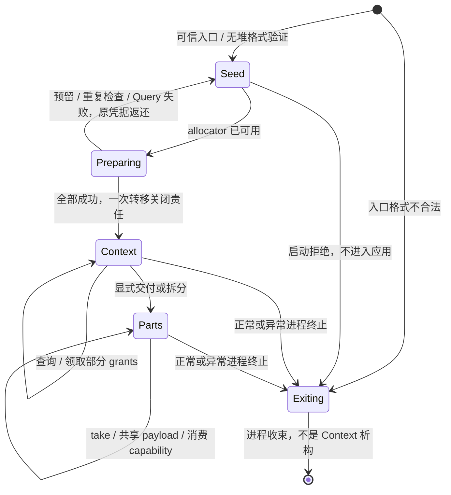

# 现有用户态分层纠正：libkernel、libprocess、libthread 与 libruntime

> 状态：设计进行中，尚未实施。仅授权调查和文档，不改代码、Cargo、ABI 或构建配置；施工另行确认，由本记录继续承接。

## 两条主线与设计归属

1. 本计划纠正已经实现的用户态结构：抽出 libkernel、建立 libthread、形成中立进程上下文，将 rinlib 的语言环境改名迁至 `user/libraries/libruntime`，分离平台构建资产并接通所有现有消费者。
2. [设备整体设计](todo-2026-09-device-system-design.md) 拥有设备领域、特权资源、驱动/总线/功能协议与真实消费者。两项设计可并行校正；设备资源代码接线以前一条迁移闭包完成为前置。

长期知识由 [framework](../notes/ideas/framework.md)、[task](../notes/ideas/task.md)、[mm](../notes/ideas/mm.md) 分别拥有；当前事实由 [framework impl](../notes/impls/framework.md) 记录。本计划只拥有证据、决定过程、尚需细化的接口、实施顺序和验证。

## 已定方向与本轮修正

runtime 并非不能有依赖，正确约束是通用知识不能反向依赖具体 runtime。用户认可库组合，本轮据此修正上一版“runtime 只指向 libkernel”的过窄图，并将线程从原拟 libprocess 分出独立 libthread。运行角色仍由实际授权与提供的协议决定，不由库名决定。

| 问题 | 已选方案 | 需要保留的边界 |
|---|---|---|
| runtime 身份 | `user/libraries/libruntime`，目录/package/默认 target/crate 同名 | 不保留 rinlib alias/facade |
| runtime 依赖 | libkernel + libprocess 的 context 模块 + libthread | 领域库都可直接复用这些 owner；runtime 不批量重导出类型 |
| 当前身份与管理 | shared 定义 Pid 等 wire 值；libprocess 定义 CurrentProcessInfo/StartupContext 等接口角色 | 启动身份是 provenance，不自动成为内核认证，不产生 ProcessControl |
| 最小 Cargo 图 | libprocess context 默认基础功能；装载/构造/监督用显式 `management` 功能集引入 ELF/libexecution | Cargo feature 合并只能编译更多 API，不自动启动行为或授予权限 |
| 线程 | libthread 拥有 ThreadRecord/ThreadObservation、wrapper、结果和 cleanup 状态机；libruntime 持有进程级 ProcessThreadRegistry（PTR）及 driver | libthread 不依赖 libprocess/libexecution/runtime；不公开可绕过 wrapper 的安全 `thread::exit`，内部 trampoline 可消费 libkernel 的 unsafe ThreadExit；Attached/Spawned 在进入 PTR 后共用同一记录和状态机，不按 TID/PID 分支 |
| 消息与 signal | Mailbox/Notification/Wait 的基础 API 在 libkernel；RPC 和事件推进各有 owner | 当前 Notification 不是 POSIX handler；默认不建立消息泵、监听线程或 root channel |
| 程序入口 | `no_main` + 所选 runtime 的 `entry!` 适配；通用 `_start` 接受现有 a0/a1 StartupBlock 参数 | 不再用 argc/argv 槽借位；内核仍只验证 ELF entry 与执行需求 |
| 启动 context | 无堆 view 校验 → allocator/唯一 `_start` 语言环境 → 附入记录交付 PTR → 显式交付应用 | 不把 env 全局变量搬家，不把 payload 伪造为无条件 static，不复制 Handle 关闭权；Rust profile 不承诺多个 Attach 入口 |
| 线程环境与结果 | 显式环境工厂、ThreadRecord 发布状态和 PTR step；准备前登记稳定记录 | 不把 DONE 当成 T 已初始化；正常 Rust 路径只发布 Returned/EnterFailed，raw 逃生保留 Unpublished 事实；TLS/unwind/detach 不在范围，driver/Attach 交接/关闭顺序仍在 TODO |
| shared 与 Rust | Termination/ProgramResult 到 libruntime，固定 ExitCode ABI 留 shared | 内核入口只保留实际所需约束，不复制用户返回值政策 |
| 平台构建 | target JSON/ISA/共同布局到 `user/platforms/`，采用通用入口符号；runtime 提供适配 | 不让替代 runtime 依赖旧 runtime 目录或编译器 main 包装 |
| allocator 与异常 | runtime owns global allocator/panic/OOM/入口 wrapper/PTR driver；libkernel 最小路径无堆 | runtime 依赖库不意味着堆初始化前可调用所有 API；普通入口返回只结束当前线程，ProcessExit 不替代优雅收束 |

自进程线程创建、映射和退出使用内核既有 self 作用域、绑定资源与准入，不新增虚构的操作 capability。通信、跨对象管理等必须有相应 authority；链接库只提供知识，不隐式增加任何权限。

普通程序可能需要某种知识，不等于 runtime 必须拥有其 API 或启动服务。未来若增加停止请求/协作取消等 runtime 事件，必须定义入口 authority、事件协议、普通线程中的处理和收束；它不是把现有 Notification 改名为 signal handler，也不是本轮默认监听机制。

## 当前基线与证据

分支 `master`、提交 `bb38eee`；延续此前设备设计的未提交文档，代码不变。

| 位置 | 当前事实 | 迁移方向 |
|---|---|---|
| `user/rinlib/src/call.rs` | 唯一用户态 RV64 ecall、错误解码与 syscall wrapper；host stub panic | libkernel 内部 call/raw 与安全出口 |
| `rinlib/src/{ipc,mm,memory_object,memory_pool,shared_memory,time,system}` | typed owner、失败返还、映射/运输/等待 | libkernel 的用户侧资源契约 |
| `rinlib/src/process.rs` | Job/Process 原语、快照校验和 drain_to_completion 混合 | 原语到 libkernel，组合管理到 libprocess |
| `rinlib/src/env.rs` | 启动块、PID/parent PID 静态变量、可反复读取 raw Handle 数组 | 格式/view/语义采用分层；libprocess context 显式转交 |
| `rinlib/src/thread.rs` | raw spawn、UserStack、闭包 packet、Join、栈清理诊断；DONE 后假定结果初始化 | 原语到 libkernel，ThreadRecord/ThreadObservation 到 libthread；新增环境失败时必须改为明确结果状态 |
| `rinlib/src/rt.rs` | lang_start 以 argc/argv 接收块基/长度、初始化 heap、main 返回转码；panic/OOM | libruntime 显式平台入口与应用交接，删除用户 lang_start 借位 |
| `rinlib/src/rt.rs:91-92` | 遗留注释提到未来监听线程接入 rt | 与当前 Notification 契约区分；实施删改旧假设，不据此默认引入监听线程 |
| `erhino_shared/src/proc.rs:276-300` | Rust Termination/ProgramResult 与 ABI 混合 | Rust 适配到 libruntime |
| `os/kernel/src/rt.rs` | T:Termination 但只调用 main 后 park，不消费返回转换 | 去除未使用的用户语言返回约束，不改 kernel boot/hart 语义 |
| `libprocess/src/lib.rs:1161` | 出生块读取 rinlib::env::pid() | 经显式 CurrentProcessInfo 取得启动方 provenance |
| `user/rinlib/*.json` 与 `linker.ld` | target 指向 rinlib/linker.ld，脚本 ENTRY(main) | 平台中立资产和 `_start` 接口 |

七个公共库直接依赖 rinlib：libexecution、libprocess、librpc、librunnel、libfal、libfs、libservice；libbudget 不依赖。另有 3 个服务、4 个验收程序、1 个驱动，共 15 个 crate。公共库不调用 runtime 初始化或 allocator；host 测试 allocator 属测试 binary。

实际 libprocess 当前还依赖 libexecution，不能声称现状已适合最小 context 依赖：本轮将其功能划分纳入迁移。当前没有 libkernel、libthread 或 libruntime crate。

## libkernel 接口与资源契约稿

本轮把公共出口、owner 和失败形状细化到下面的 API 面。长期语义由 [kernel-interface](../notes/ideas/kernel-interface.md) 拥有，具体 Rust 模块组织和迁移对应在本记录。表中接口名为拟定出口，不是已经存在的代码；不冻结字段布局或为尚未设计设备预留调用号。

| 目标模块/出口 | 类型与调用形状 | 资源、失败与停驻 | 当前来源 |
|---|---|---|---|
| 私有 call/backend；窄 raw 边界 | syscall 寄存器/错误解码；必要入口以 unsafe 暴露 | 不分配用户堆；是否 park 由具体调用而非 unsafe 标记决定 | rinlib/call.rs |
| object/capability | `Capability::borrow()`、`description()`、显式 `duplicate(rights)`、`close(self)`；`CapabilityRef<'_>` 只借用 | duplicate 返回新 entry；close 失败返还原 owner；合法非映射 Close 可等待内核退休 | ipc/capability.rs、object.rs |
| role 转换 | `T::try_from(Capability)` 或等价 named adopter；失败包含原 Capability | 先有独占来源证明，再查 role/rights；不能以 Query 创造关闭权，已知不可变描述可以沿 owner 复用 | 现有 sender/mailbox/invitation 等 adopter |
| memory | MemoryPool/MemoryObject、MappedRegion、SharedMemory view；Map/Unmap/Protect/Seal | 无用户堆基础路径；Map/Unmap 可 park；失败返还 region 或相应 owner；不补造 Drop 回收方案 | memory_pool/object、mm、shared_memory |
| process 原语 | JobControl、ProcessControl、ProcessBuilderHandle；Create 返回 builder/control/pid 的一组 owner，Query/Drain 是单步 | Builder 非 Clone，Start 消费它，失败保留；Control close 不代表已 Drain；高层 ProcessBuilder 仍归 libprocess | rinlib/process.rs 的原语部分 |
| Building 资源转交 | `bind_memory(builder, pool)`、`grant(builder, batch)` | Bind 失败返还 pool；Grant 失败返还批次，成功返回 child-local 数值集合而非本进程 Capability；输出容量预备后提交 | process.rs / libprocess 现有组装 |
| thread 原语 | ThreadControl、ThreadSpawn/ThreadExit/Wait；裸执行地址入口 unsafe | Spawn 成功交 tid/control，资源 packet 由 libthread 保活；`ThreadExit(code)` 只在 libkernel 作为 unsafe 原语，Join/TLS/栈政策不下沉 | call.rs、thread.rs 的内核操作 |
| ipc/message | Mailbox、MailboxSender、SendOnce、Lifetime/Delivery、Packet、ReceiveBuffer | Send/Receive 非阻塞；失败返还未消费的 packet/sender；接收前预付结果 owner 空间，不在安装后才分配 | ipc/message.rs、packet.rs |
| ipc/notification | 补 NotificationOwner/NotificationSignaler 安全包装，create 原子返回双 owner，take/signal/borrow | owner.take 显式消费位；signaler 不消费；不建异步 handler 或默认频道 | notification.rs 当前 raw-only，新增包装不新增 syscall |
| ipc/tunnel | Endpoint、EndpointCleanup、Invitation、AttachFailure | Endpoint 绝不擦成通用 Capability；映射借用约束关闭；Attach 区分未提交返还与已消费 cleanup | tunnel.rs、invitation.rs |
| wait | WaitMany、WaitSet、观察输入和结果容器 | 输入为借用/观察，不取得关闭权；显式等待；注册持久性不复制业务 owner | wait.rs、wait_set.rs |
| time/system/debug | Deadline/MonotonicNow/SleepUntil、自进程退出、受权 SystemReset、零堆 Debug | 值操作不分配；Sleep 明确等待，Reset 只在拒绝时返回；无服务关机政策 | time.rs、system.rs、dbg.rs |
| startup view | 从可信入口取得的稳定字节视图和无堆格式访问 | 原始指针接管 unsafe；只读视图不授予原始 Handle 采用权；解码兼容现 outer 的非对齐输入 | env.rs 的字节接收 + shared/startup 校验 |

低层 ProcessBuilderHandle 与 libprocess 的 ELF/多步骤 ProcessBuilder 不同，不能通过同名重导出隐藏职责。ProcessControl/ThreadControl 只拥有本地表项；public Thread 只持有观察/控制 capability，PTR 的 ThreadRecord 组合用户态栈、结果和 cleanup 义务。原始数值提取不是复制 authority，所有会消费裸值的安全捷径须删除或变成有前置条件的 unsafe 边界。

统一失败纪律是按操作形状保留责任，不是强制每个 API 都套同一泛型错误：借用操作不消费输入，新建失败不遗留新 owner，消费操作失败返还输入，已提交部分结果显式返回 cleanup。已有的 Invitation/Endpoint 特殊结果保留，不压成单个 SystemCallError。

### 源码核实与必须纠正的前提

- 普通 `libprocess::write_birth_block` 当前使用 READ|WRITE；init 的 map_bootstrap_block 则只读。`env` 返回静态不可变视图不等于普通启动已经有硬件只读保证。后续实施把普通出生块改为 READ，仍通过 Building Write 填充；`task/proc.rs::write_building` 明确允许不具写权限的最终 PTE，无需新增 syscall。
- 起始地址/字节长不足以重建 MappedRegion 的 reservation/backing owner。本次统一为进程寿命启动映像，不新增 StartupUnmap，也不复制大 initfs。该选择与现有 init payload 保活一致；未来提前释放需独立契约。
- HandleQuery 只读且不转交 owner；role adopter 不能独自防止双重接管。StartupSeed 的一次来源和查询结果必须同时成立。
- 非映射 Capability 与 Endpoint 不可混用；现有 Receive/Packet 的预付容器可以复用其机制思路，但初始 grants 不受消息的固定八个槽限制，不能直接拿消息上限限制 StartupBlock。
- Send/Receive 在 message idea 中明确为业务非阻塞；带 Deadline 不等于等待重试。分配准备、业务等待与内核退休 park 必须分别标注。
## libthread 接口稿与平台入口核实

线程的目标契约由 [task](../notes/ideas/task.md#线程环境与结果交接) 拥有；本节把施工前需要的 API 责任和当前 psABI/内核事实登记到分层计划。

```rust
// 设计轮廓，PTR 是进程级唯一生命周期 owner。
pub unsafe trait ThreadEnvironment: Send + Sync + 'static {
    type State: Send + 'static;
    type Fault: Send + 'static;
    fn prepare(&self) -> Result<Self::State, EnvironmentPrepareFailure<Self>>;
    unsafe fn enter(&self, state: Pin<&mut Self::State>) -> Result<(), Self::Fault>;
    unsafe fn leave(&self, state: Pin<&mut Self::State>) -> Result<(), Self::Fault>;
    fn retire(&self, state: Pin<&mut Self::State>) -> EnvironmentRetireStep<Self::Fault>;
}

pub struct ThreadRecord { /* private stack/result/environment/control */ }
pub struct ThreadObservation { /* cloneable, invalidatable observation */ }
pub struct Thread { observation: ThreadObservation }
pub struct ThreadDriver { /* libruntime-owned PTR step scheduler */ }

impl<E: ThreadEnvironment> ThreadFactory<E> {
    pub fn prepare<F, T>(&self, task: F)
        -> Result<PreparedThread<E, F, T>, PrepareFailure<E, F>>
        where F: FnOnce() -> T + Send + 'static, T: Send + 'static;
}
impl<E, F, T> PreparedThread<E, F, T> {
    pub fn start(self) -> Result<Thread, StartFailure<Self>>;
    pub fn cancel(self) -> CancelReport<E, F>;
}
impl Thread {
    pub fn wait(&self, deadline: Deadline) -> Result<WaitStatus, WaitFailure>;
}
```

公开 `Thread` 只观察/控制；`T` 的一次性领取仍是 libthread 的承诺，但不能在未明确结果存储寿命、无人领取时析构以及 PTR record 退休后的过期行为前冻结 `ResultReceiver<T>` 签名。栈、环境、ThreadControl 和 cleanup 责任由已采用记录的 libruntime PTR 持有。Attached 与 Spawned 采用后使用相同状态机，ThreadRecord 不从 PTR 暴露为可任意 Drop 的值。`reap_step` 只执行一个有界动作，`KernelDone` 仅授予 cleanup 资格；只有 cleanup 与结果责任均结算才能释放 record。libruntime 的 ThreadDriver 调用该 step，具体调度和关闭策略仍由[用户内存 owner 计划](todo-2026-09-14-user-memory-owner-lifecycle.md)的 TODO 冻结。

环境 trait 的 unsafe 论证涵盖 State 稳定地址、初始化标志、先后顺序及异常离场后可在收束者执行的退休子集。prepare 失败若已取得资源须返还未完成状态/cleanup；enter/leave 以独占 Pin 借用更新 State，失败不吞掉 State。retire 一步返回进度、观察或错误，不在 Drop 运行任意业务循环；只有 phase 已允许退休的代码可以调用，不向安全调用者公开可提前 retire 的原始 State。环境接口不接管 closure 调用或 ThreadExit；libthread 内部 trampoline 负责普通线程，libruntime 的首入口适配复用同一终结协议。

State 创建时可移动，放入稳定 packet 后至 DONE/退休完成不得搬动；错误返还也必须保留这一位置。父子访问沿生命周期转交，不因 Send 就形成并发 &mut。当前 Rust 环境没有 TLS/unwind，可以采用空状态实现，但必须遵守相同阶段。代码块省略完整类型约束与错误字段，不作为已经通过编译的公共签名。

### 接口步骤和返回形状

| 阶段 | 输入与 owner | 可能结果 | 谁继续处理 |
|---|---|---|---|
| `ThreadFactory::prepare` | factory 的显式环境、栈策略、PTR 记录容量；调用者拥有 closure | PreparedThread；失败由 PTR 保留/返还原任务和环境状态 | PTR 与调用者按失败路径继续 |
| `PreparedThread::start` | PreparedThread 独占 packet/stack/environment，提交前已登记 PTR | public Thread；结果领取形状待闭合；未提交失败保留 PreparedThread；提交完整性失败进入进程故障策略 | PTR；Thread 只拿观察/控制 capability |
| 子侧 enter/run/leave | PTR 保活的 ThreadRecord 与 packet | Returned/EnterFailed/Unpublished；trampoline 调用 ThreadExit | 子侧直到 publication；之后 PTR driver |
| `Thread::wait` | 借用观察/控制 handle | Ready/TimedOut/观察错误，不移动 PTR owner | 调用者观察；PTR 仍持有 record |
| 结果领取（接口待定） | 一次性领取权与独立寿命证明 | 已发布 T 只交付一次；未领取时仍有析构 owner | 调用者取得 T；PTR/结果存储按协议结算 |
| `cancel` | 未发布 PreparedThread | 返还未执行任务和 Complete/Pending cleanup | 调用者；未创建运行线程 |
| cleanup 推进 | PTR 独占 ThreadRecord；driver 取得单步 claim | Continue/Wait/Complete/Failure；失败保留 record 和进度 | libruntime ThreadDriver |
| `Drop(Thread)` | 公开观察/控制 handle | 只放弃该 handle，不触碰线程资源 | PTR 继续持有 record |

ThreadOutcome 区分 Returned(T)、EnterFailed；结果初始化与发布字分开，内部仍保留 Unpublished 事实供 raw 逃生和完整性处理，不能读取未初始化的 T。leave 失败仍保留正常 T 并记录独立环境结束错误。未执行 closure 在 DONE 后丢弃一次，已移入任意栈帧的局部对象不得由收束者猜测析构。显式错误报告、结果及清理 owner 的 Send/Drop 条件随同其实际资源定义。

### 当前实现对照与迁移限制

当前 `rinlib::thread::JoinHandle::join` 直接等待 DONE、fence acquire、关闭 Control、解除栈，再读取 `MaybeUninit<T>`；Drop 同样等待并 Drop 结果；栈 Unmap Busy 会 sleep 重试，非 Busy/睡眠失败只记录 abandoned count 并把映射留到 ProcessDrain。目标 `libthread::ThreadRecord` 不得照搬这段 public owner 语义：清理失败必须留在 PTR record 和单步状态机，结果发布必须有显式状态，raw `ThreadExit(code)` 只存在于 libkernel 的 unsafe 边界，不作为 libthread 的安全函数；公开 `Thread` 只持有观察/控制能力。

当前内核 ThreadSpawn 在成功写出 `ThreadSpawnResult` 后提交 Handle/成员/Ready；输出写失败会请求进程终止，未把“内核成功但用户结果不可写”伪装成未启动。这保持为 libkernel 的固定完整性边界。当前 ThreadStartContext 只设置新线程的 PC、SP、a0/a1，gp/tp 在出生现场为零；子线程入口必须由 runtime/libthread 入口代码初始化 gp，TLS 目前关闭。

当前附入线程由内核以 a0=StartupBlock 基址、a1=长度、SP=用户栈顶创建，再经 rustc main shim 借 argc/argv 进入 lang_start；目标改为显式 `_start`，由 Rust profile 采用一个附入 entry record 并登记到 PTR。这要求实施同时改入口符号、Attach 的 control/栈 owner 交接、target/linker 资产和 runtime 适配，不能只改 libruntime 的 Rust 模块。

### 入口和 profile 事实门

- RISC-V psABI v1.0 要求程序入口自行初始化 gp，并规定 gp/tp 为不可分配寄存器；本地规范 `riscv-elf.adoc` 要求 gp-relax 相关入口使用 `.option norelax` 初始化 `__global_pointer$`。当前用户 linker 没有该符号，不能把链接器未定义行为作为契约。
- psABI 的普通函数参数不定义 eRhino 的进程出生 a0/a1；系统自有 StartupBlock 约定继续由平台 `_start` 拥有。
- 当前 Base64 为 RV64IMAC/LP64、FS 关闭；D64 对应用户 GC target 的 RV64IMAFDC/LP64D，内核保存完整 FPR/fcsr。内核在入用户态前配置 FS，用户入口不能写 sstatus 或改变调度 profile；两个入口适配均只使用共同整数指令完成准备。
- 当前 ELF admission 拒绝 PT_TLS，tp 不承诺 TLS。TLS 若未来启用，必须同时改变 admission、每线程 TCB/线程上下文、入口和替代 runtime 契约；本轮不实现。
- 所有用户 sp 必须满足当前内核/psABI 的 16 字节对齐；ThreadStartContext 的入口/栈校验仍由内核完成，用户安全包装还要保证 packet 和 stack 映射寿命。
- `_start` 的返回类型为 never；Rust 入口 wrapper 负责发布用户态结果并结束当前线程，不能借平台入口的 argc/argv 包装。固定 ExitCode 只在明确的 runtime/语言终止政策或末线程进程终态中使用，不把 main 返回默认改写为 ProcessExit。

这些事实足以锁定接口顺序，但不锁定具体汇编文件和 target JSON 字段。实施前要在钉住工具链下验证 `.option norelax`、`__global_pointer$`、Rust `no_main`/宏入口和链接段；失败时更新唯一计划，不用未证实链接器行为继续施工。

固定证据：本地 psABI v1.0 `riscv-cc.adoc`「Integer Register Convention」「Integer Calling Convention」（SP=128 bit 对齐）、浮点寄存器/fcsr；`riscv-elf.adoc`「Global Pointer」「Global-pointer Relaxation」与 TLS。规范定义链接布局/机器调用约定，不定义 eRhino 进程出生 a0/a1。源码证据为 `context.rs` 的零初态、`task/proc.rs` 出生字段与 `assembly.asm` 的完整恢复、`fp.rs` 的 FPR/fcsr、`shared/elf` 的 PT_TLS 拒绝；它们不证明旧用户入口已经初始化 gp。未采信某版本 lld 对未定义 gp 符号的推断。

规范固定入口：[psABI v1.0 调用约定](../references/normative/riscv-psabi-v1.0/riscv-cc.adoc)、[psABI v1.0 ELF 与 relaxation](../references/normative/riscv-psabi-v1.0/riscv-elf.adoc)。具体行号可漂移，以所列固定版本和小节核对；新编译器的产物仍须另做实施证据。

平台门：两个用户 target 都要检查最终 ELF `_start`、首/工作入口的第一段反汇编、gp 初始化不可被 relaxation 删除、a0/a1 未被破坏、SP 对齐、Base64 适配无 FP、D64 门由内核配置，以及旧 ENTRY(main)/lang_start 路径已消失。当前只取证规范与源码，未生成或反汇编新镜像。

### 本轮线程场景走查

| 场景 | 契约结果 | 尚需的前置 |
|---|---|---|
| 准备环境/栈失败 | 任务不运行；原任务与部分环境/映射 owner 留在失败报告 | 失败报告 Drop 的预付退休槽 |
| 发布后子线程先于父侧返回完成 | packet 已稳定、结果先写后发布；父侧只补接内核 Control，不搬动 packet | Prepare-before-Spawn 和无父子锁依赖的实现证据 |
| 子环境进入失败 | 不调用 F，未执行 F 与部分状态在 DONE 后处理；outcome=EnterFailed | 环境错误与状态的独立所有权 |
| T 已返回但 leave 失败 | T 保持有效；leave 错误单独报告，残余环境进入 cleanup | 环境不得留有对已交付 T 的访问依赖 |
| 等待超时/观察错误 | 原 Join owner 返还，不杀线程、不回收栈 | deadline 不撤销已提交内核操作 |
| DONE 后 Unmap Busy/失败 | outcome 与 ThreadCleanup 分开；重试不再次取结果或关 Control | 正式退休 owner 的预算/唤醒/活性 |
| raw ThreadExit 绕过 trampoline | 没有发布 T 时保留 Unpublished 事实，不读未初始化 T | 普通安全 closure 不暴露此逃生口，raw 自负局部析构责任 |
| 子线程依赖已 Drop 的父 factory | 每线程持有环境/退役的独立有效引用，不从失效 factory 查全局 | 承接域不能依赖 factory 被轮询 |
| Drop/error Drop | 不能通过 must_use 阻止，失配不能假装安全退化 | 映射 owner 计划中的必成接收与进程停止顺序 |

这些是接口级证明义务，不是测试结果；退休域未闭合前，不能标记 libthread 已可施工。

## libprocess::context 接口契约稿

具体时序与寿命的唯一契约见 [bootstrap 接收章节](../notes/ideas/bootstrap.md#用户态接收与一次性交接)。context 的这些 API 不依赖 management/ELF/libexecution/libthread/runtime；采用阶段需要 alloc，但不安装 allocator。

```rust
// 接口轮廓；不是可编译代码，错误内部字段与实现布局不在这里冻结。
impl StartupSeed {
    pub unsafe fn from_entry(base: *const u8, len: usize)
        -> Result<Self, StartupParseError>;
}
impl StartupContext {
    pub fn adopt(seed: StartupSeed) -> Result<Self, StartupAdoptFailure>;
    pub fn current(&self) -> &CurrentProcessInfo;
    pub fn payload(&self) -> &StartupPayload;
    pub fn grants(&mut self) -> &mut InitialGrants;
    pub fn into_parts(self) -> (CurrentProcessInfo, StartupPayload, InitialGrants);
}
impl CurrentProcessInfo {
    pub fn pid(&self) -> Pid;
    pub fn parent_pid(&self) -> Pid;
}
impl StartupPayload {
    pub fn bytes(&self) -> &[u8];
}
impl InitialGrants {
    pub fn slot(&self, index: usize) -> Result<GrantSlotInfo, GrantIndexError>;
    pub fn take(&mut self, index: usize) -> Result<Capability, GrantTakeError>;
    pub fn close_remaining(self) -> Result<(), GrantsCloseFailure>;
}
```

| 类型/结果 | 精确责任 | 复制与线程条件 |
|---|---|---|
| StartupSeed | libprocess context 拥有的入口接收凭据；内部借助 libkernel 稳定 view；尚未有 typed owner 的初始表项全部由它承接 | 非 Clone；唯一入口跨 unsafe 构造。正常新线程不得再次构造；raw 指针可读/稳定/独占采用是 SAFETY 前提 |
| StartupAdoptFailure | 错误原因、必要的槽位定位、完整原 Seed；没有部分 Capability 被创建或关闭 | 预留失败可重试；格式、重复/无效 handle、未知或不支持 role、Query 错误不能跳过进入应用 |
| CurrentProcessInfo | private 构造，保存已交付 provenance；PID/parent PID accessor 不请求管理权 | Copy/Clone；不提供从任意 parsed bytes 到此来源视图的安全构造器，仍非认证身份 |
| StartupPayload | 持有进程寿命只读映像的 view 凭据；不拥有 unmap 或原始 Handle 数组 | Clone + Send/Sync 以稳定映像不变量为 SAFETY 依据；bytes 的借用不越过视图借用，不输出 static slice |
| InitialGrants | 一组已采用非映射 Capability，每槽独占，缺失槽不可恢复成原 owner | 非 Clone；Send，非 Sync，跨线程 move 或应用显式加锁；无 raw 数组全局 getter |
| GrantSlotInfo | Available 的不可变 entry 描述或 Taken；越界独立返回错误 | 描述可复制但不是关闭/转交权，不缓存动态 signals |
| GrantTakeError | IndexOutOfRange / AlreadyTaken 等不消费结果 | 保留容器和其它所有槽；成功后 typed 转换失败由调用者持有返还 Capability，不隐式放回槽 |
| GrantsCloseFailure | 未关闭的剩余 InitialGrants 与具体失败位置/原因 | 已成功关闭的槽保持 Taken，不重复关闭；残余显式可继续处理 |

from_entry 先作不分配的 outer 校验；失败时没有安全 adopted owner，runtime 按早期失败路径退出，不能猜测 raw Handle 做 Drop。字节可读与稳定是原始边界的前置，格式校验不验证任意指针的可访问性。shared 解码允许非对齐输入，采用侧应按值解码 Handle，不能未经对齐检查构造 typed Handle slice。

adopt 顺序：预付全部 slots/验证工作区 → 拒绝重复 Handle 数值 → Query 每个 entry 并核实安全可采用的非映射 role → 一次消费 Seed → 无分配/无失败地安装所有 owner 和 Context。kind/role/rights 的已核实不可变描述随 owner 复用；两个不同 Handle 对应同一 object_id 合法。Seed 移交关闭责任由 libprocess 的局部 unsafe adopter 完成，论证同时引用来源唯一性和 Query；不让 libkernel 反向依赖 StartupContext。

采用前 role 集合以当前 ABI 完整矩阵核对：内核可 GRANT 的 Mailbox/Notification owner、sender/signaler、MemoryObject/Pool、Job/Process/Thread 控制、ProcessBuilder、Invitation、Lifetime/Delivery、WaitSet/SystemReset 都不能因“不是普通 sender”被遗漏；本地 mapping-bound Endpoint 拒绝。最终 rights 可能已去除 GRANT/TRANSIT，不据此拒收。后续新增 role 必须同步 adopter 与验证，不将未知 role 当叶子猜测关闭。

Context 不主动创建 mailbox、notification、thread 或 self ProcessControl；空程序可有零 grants。初始四项 primordial graph 仍由 shared/startup::initial 与 init 解释，普通 context 不预置这些索引的业务含义。

### 采用状态与提交点



这不是内核事务或新增 ABI 状态；采用提交是用户侧 owner 建立点。初始 entry 在进入 runtime 前早已存在，不在 adopt 时重新铸造。若 runtime 早期退出，实际 HandleTable、堆 arena 和地址空间由既有进程收束负责；不调用尚未建立的服务或用 PID 选择特殊特权退出。

### 消费者与失败走查（设计证据）

| 场景 | 沿契约应出现的行为 | 是否影响接口 |
|---|---|---|
| 普通空程序 | 零 grants、空 payload 合法；不创建监听器或线程；context 不拉入 management | 本轮 context 基础接口覆盖 |
| init 与大 initfs | payload 保持原映射，不复制进堆；四个初始角色按索引 take 一次，之后子进程装载持 payload view | 需要 StartupPayload Clone/进程寿命，而非普通 MappedRegion Drop |
| 创建子进程 | builder 从显式 CurrentProcessInfo 取 provenance；Grant 成功的 child-local 数值进入只读出生块，Start 之后 receiver 采用 | 调整 launcher 权限与调用签名，不新增内核 ABI |
| 带 RPC 的服务 | take Mailbox/相关能力，role 转换成功后构造 librpc 对象；转换失败仍有原 Capability；剩余 grants 可显式关闭 | 不创建第二套 startup/RPC 运输类型 |
| 重复 Handle / 无效 role | 在提交前拒绝，尚未生成双 owner；不误判同 object 的两个不同 entry；Endpoint 不转为通用 owner | 需错误可定位并返还 Seed |
| 元数据预留失败 | 不关闭初始能力，不调用应用；可重试或进程失败收束 | 与 allocator 无堆准备分离 |
| 跨线程读取 payload | 移交或 clone 只读视图，grant bank 仍单一 owner；dropping context 不使 payload 悬垂 | 无强制复制/Arc 回收或隐式全局 env |
| Map/Close 期间线程终止 | 已提交内核责任不取消；调用帧/结果义务直到离场屏障，startup/adopter 不伪造成功 | libkernel 完成形态已明确；libthread 实现仍需单独细化 |

这是一轮 context 接口与场景走查，不是运行测试；libthread 与入口的后续细化已记录在前文对应章节，不能由本表推断整个运行环境已可施工。

## 实施顺序

完整第一主线是一个迁移闭包，中间步骤不要求各自交付，也不能为了中间编译创建永久 facade。

1. 完成上表接口、启动与线程时序、Cargo feature 图、平台入口与验证矩阵，取得代码实施授权。
2. 建立 libkernel 并迁入底层原语/owner；迁移平台资产与 shared/Rust 返回值归属，同步受影响的内核入口约束。
3. 建立 libprocess context 基础模块及独立 libthread；在底层图成立后接通 libexecution，再接入 libprocess management、librpc/librunnel 等实际依赖者。不能把整个当前 libprocess 错排在 libexecution 前。
4. 形成 libruntime：初始化 heap/Attached entry、采用 StartupSeed/context、构造 PTR/ThreadDriver 和线程工厂并显式交付应用；普通 launcher 以最终只读权限填充出生块。同步所有 binary 的 no_main/entry! 及平台 `_start`，不保留旧 main/argc/argv 或 raw startup_handles 全局通道。
5. 接通 libfal → libfs/libservice 及全部真实消费者，删除 user/rinlib、旧 imports/re-export/alias/syscall 副本和 target/linker 路径。用显式依赖区分 binary 与普通库。
6. 更新 impls/工具/手册，结构与运行验收通过后完成本主线；设备资源代码开始接线。

改名同步面：workspace/manifests/Cargo.lock、.cargo config、两种 target、linker/入口、Justfile host 清单及 FP 路径、编译失败示例、所有导入、编辑器词表、当前文档。历史固定提交记录保留 rinlib。ELF 工具当前不识别 runtime 名，继续依据 ET_EXEC、入口范围与执行 profile 验证。

不新增第二个 runtime、通用 std facade、TLS、unwind、detach 或自动消息泵。退休承接是否需要常驻推进者须按活性取证，在所属计划中决定；不以“禁止后台”预先排除唯一正确方案，也不把一个未闭合的承接接口当作已完成的运行体。

## 与其它专题的接点

- 设备设计继续使用正确分层；runtime 可组合线程/上下文不会使 libdriver/libdevice 反向依赖 runtime，也不改变它们的授权来源。
- [用户映射 owner](todo-2026-09-14-user-memory-owner-lifecycle.md) 的线程 cleanup 子集已触发，是本次分层的硬前置：必须设计 PTR 登记、ThreadObservation 失效、ThreadDriver 单步推进和关闭活性，不能以 abandoned count 延期。它继续独占 PTR/cleanup 的具体方案；其它 allocator/映射扩展仍按独立需求，不为一个前置重做全域。
- 保留区、IRQ、内核预算、关机等原计划仍各自拥有领域功能。本主线不以 ProcessExit 冒充其正常收束。

## 施工与交付门

设计门：具体 public API/unsafe/失败表、两种启动/线程时序、context 与 management 的 Cargo 分离、固定平台证据及所有消费者迁移图闭合。当前尚未完成这些签名级证据，仍不进入代码施工。

实施门：

- runtime → context/thread/kernel 单向成立；没有领域库反向依赖 runtime，没有私有 env、默认 authority 或全局 hook。
- libprocess context 可独立于 management 编译；feature 合并不改变 runtime 启动行为。libthread 与 libexecution、libprocess 管理层无环。
- StartupContext 的身份、payload 和 capability 责任分开；Seed 独占采用、重复/再次领取被拒绝；启动映像统一只读并由地址空间保活至进程结束，来源说明不冒充内核认证。
- 栈/结果/环境/Control 到 DONE 及 Map 义务解除后才可回收，失败保留 owner；不对未初始化结果执行读取或 Drop。
- allocator 最小路径无递归分配；main/线程返回、panic/OOM、ProcessExit 与上级 Drain 各有明确边界。
- no_main/entry! 与 `_start` 满足平台 ABI；无旧 lang_start 借位/ENTRY(main) 路径，内核不依赖用户 runtime。
- 按构建手册完成依赖/feature/符号、host/compile-fail、两种用户 target 与内核入口、真实启动和退出及完整 acceptance；不临时造替代 runtime 验收体。
- 旧代码路径和配置已删除，当前 impls 与真实源码一致，历史证据保持原事实。

## 跨会话接力断点

### 工作树与授权

- 接力时分支 `master`，HEAD `bb38eee4da8390d15a71673e244b99db1752053b`。本会话所有改动留在工作树，未 commit/push。下次先核对差异，不清理或覆盖这些未提交设计。
- 当前仅授权只读取证、notes/规则文档与 todo 规划；**尚未授权 Rust、Cargo、ABI、target、构建脚本实施**。设计准入完成后再确认代码施工。
- 工作树中的新 kernel-interface/framework impl、本计划、设备整体计划和概念稿档案均为本次成果，尚未跟踪也须保留。`plans/archived/todo-2026-09-device-architecture.md` 只表示初始概念稿完成，不代表设备详细设计完成。

### 已确定，不重复选方案

| 内容 | 当前结论与归属 |
|---|---|
| 两条主线 | 先纠正既有用户态结构，再实施设备模型；两项设计可并行，代码接线有前置。设备记录独立拥有 D0—D6 |
| 库组合 | libkernel 资源契约、libprocess context/management、独立 libthread、libruntime 程序环境；runtime 可单向组合知识库，库不反向依赖 runtime |
| 改名与构建 | rinlib 的 runtime 部分迁到 libraries/libruntime，不留 alias/facade；target/共同布局到 user/platforms |
| 资源接口 | kernel-interface idea 与本计划 API 表已确定 value/borrow/owner、消费失败返还、分配/等待/退休区别；仍需编译级接口与全部消费者验证 |
| 启动 | StartupSeed 一次来源与 role 核实分开，StartupContext 分离身份/payload/grants；出生块统一只读、地址空间保活到进程结束；普通 launcher RW 是待纠正代码事实 |
| 线程 | PTR 持有 ThreadRecord，公开 Thread 只观察/控制；Attached/Spawned 注册后共用状态机；ThreadDriver 在 libruntime 推进单步 cleanup | libthread 不公开安全 exit，raw ThreadExit 只留在 libkernel unsafe 边界；driver/Attach 交接/关闭顺序仍是 TODO |
| 平台入口 | no_main/entry!/_start，Attached entry/Spawned wrapper 均准备 gp、保持参数/SP；内核拥有 FP gate，当前无 TLS。已有 psABI/源码证据，尚无新镜像编译/反汇编证据 |
| 现有基座 | libexecution 已有 task/source 准入、失败保留/退避与注销/停止；FAL 和 init 已有正式退休/监督消费者。不能重新把整套基座列为缺失 |
| 系统定位 | 不以 POSIX 兼容为目标；多用户非刚需，未来政策归用户态；本轮不建设 TLS/unwind/自动消息泵/第二 runtime |

### 尚未闭合与继续顺序

1. **PTR/ThreadRecord 的 owner 与状态机已冻结**：PTR 独占生命周期记录，public Thread 只持有可失效观察/控制对象；Attached/Spawned 注册后共用状态机，KernelDone 只授予 cleanup 资格。
2. 下一步回填 `ThreadRecord/ThreadObservation` 与 libruntime `ProcessThreadRegistry` 的具体类型、atomic 状态、结果领取、唯一 cleanup claim 和 vtable unsafe 证明；现有接口代码块仍是施工草案，尚未改代码。
3. ProcessAttach 尚未交付可供 PTR 观察的 child-local ThreadControl 和栈 owner descriptor；须闭合构建者预备、子进程入口采用、未采用/失败时的 owner 与提交时序，不能把“进入执行前登记 PTR”套在已附入线程上，也不能以 TID 1 分支替代。
4. `T` 的结果领取存储与 PTR cleanup/record 退休并发时的寿命、无人领取时的析构、观察/领取权失效规则仍是 TODO，不能冻结 `ResultReceiver<T>` 签名或提前释放 packet。
5. `libruntime::ThreadDriver` 的实际执行形态、唤醒来源、reap 时机、PTR 非空关闭、driver 失效和最后执行者边界仍是 TODO；不能只凭 PTR 的 step API 宣称活性。
6. Rust profile 只支持一个 `_start` 入口已冻结；PM 不为当前 Rust contract 构造多个 Attach 入口，内核多 Attach 能力留给其他 user contract。
7. 完成功能 context/management 切面、全部现有消费者调用与构建迁移矩阵；核对 startup/权限/线程调用并更新真正受影响的 ABI，两侧同步而不为搬目录无故改 ABI。
8. 将平台链接入口、unsafe/类型约束和全部失败表整合为施工方案及验证门。设计期未修改代码，不提前运行以目标实现为前提的测试；施工期按构建手册验证 Base64/D64、内核入口和整体验收。

### 设计阶段与施工阶段裁决（2026-09）

下列事项不会等施工“自然长出来”。凡是决定 owner、失败返还、依赖方向、ABI 或入口契约的内容，先在设计阶段固定；施工阶段只落字段、文件和机械迁移。

| 事项 | 阶段裁决 | 当前方案 |
|---|---|---|
| cleanup record / ThreadCleanup | 设计阶段 | `ThreadRecord` 在 prepare/Attach 交接前稳定登记到 PTR；PTR 独占栈、结果、环境、Control 和 cleanup 状态；step 只允许唯一 claim，失败保留 record 和 Charge |
| ThreadResource 预算 | 设计阶段固定类别，施工阶段定具体限额 | `RegistrySlot` 计活跃 ThreadRecord，`CleanupBytes` 计 record；具体容量、ready 等待结构和 driver 预算仍由 runtime 装配 TODO 冻结；cleanup 完成或准备失败才退款 |
| PTR/driver 故障 | TODO | driver 失效、PTR 非空关闭、Ready/Claimed record 保留和进程故障/ProcessDrain 边界尚未冻结；不在故障路径临时 spawn |
| Thread 观察失效 | 设计阶段 | public Thread 可 Clone/Drop/失效；观察壳不拥有 ThreadRecord，slot/generation 只用于过期拒绝，不用于身份政策 |
| Cargo 依赖图 | 设计阶段 | `libkernel` 不依赖上层；`libprocess::context` 只依赖 libkernel/shared；`libthread` 依赖 libkernel/libbudget，不依赖 libprocess/libexecution/runtime；`libexecution` 不依赖 libthread；libruntime 持有 PTR/driver 并组合两者，libthread 内部 trampoline 可直接调用 libkernel unsafe ThreadExit |
| rinlib 模块归属 | 设计阶段 | call/ipc/mm/memory/time/system/debug → libkernel；process 原语 → libkernel，context/management → libprocess；thread → libthread；env/startup → libprocess::context；rt/allocator/panic/entry → libruntime |
| 平台入口 | 设计阶段固定协议，施工阶段取证 | 平台 `_start` 先初始化 gp，再把 a0/a1 交给 libruntime；runtime 初始化 heap、采用一个 Attached entry record、登记 PTR 后进入统一 wrapper；删除 ENTRY(main)/argc/argv 借位 |
| 消费者迁移 | 设计阶段固定责任矩阵，施工阶段逐 crate 修改 | 七个公共库、三个服务、四个验收程序和一个驱动按实际 owner 迁移；不保留 rinlib facade/alias；每次迁移同步 Cargo、import、target 和文档 |
| Rust 字段、模块文件、helper、默认容量 | 施工阶段 | 只要不改变上述契约，可由实现按代码结构决定；容量数值由真实装配者和资源模型给出，不能写无依据的全局常量 |
| 编译错误、import、target 路径、linker 段 | 施工阶段 | 按依赖顺序修正并保留编译/ELF/反汇编证据，不提前在设计文档穷举 |

#### 施工时的固定依赖顺序

```text
1. libkernel：迁移 raw call、typed owner、NotificationSignaler、memory/process/thread 原语
2. libprocess::context：StartupSeed/Context/InitialGrants，独立于 management
3. libthread：ThreadEnvironment、ThreadFactory、ThreadRecord/Observation、登记端口、cleanup step、内部 trampoline
4. libruntime ThreadDriver：持有 PTR，接入 libexecution 或其他 runtime 执行上下文；不把 libthread 依赖倒置进执行器
5. libprocess::management、librpc/librunnel/libfal/libfs/libservice 及服务消费者
6. libruntime/platforms：_start、gp、heap、panic/OOM、main/ExitCode
7. 删除 rinlib、旧 target/linker/import/re-export，执行完整验证
```

#### Kernel 与 shared 的施工边界

当前线程 cleanup 方案不要求新增 kernel 线程；ProcessAttach 为 PTR 交付 control/栈 owner 可能需要同步扩展 Attach/Grant/Startup ABI，是否采用及具体形状仍在 TODO。kernel/shared 只有以下已设计或待核对的同步项可能进入同一迁移闭包：

- `shared` 保留固定 ExitCode/进程退出 ABI，把 Rust `Termination/ProgramResult` 适配移到 libruntime；`os/kernel/src/rt.rs` 删除没有实际消费价值的用户语言 `Termination` 约束；ThreadExit(code) 仍是线程/末线程进程终态的低层输入，不承担 Rust 泛型结果；
- 保持 ThreadStartContext 的 PC/SP/a0/a1 与 DONE/Control 完整性语义；gp 由用户 `_start`/线程入口初始化，TLS 继续不实现；Attached/Spawned record 在 PTR 登记后由同一 wrapper 发布用户态结果并消费 libkernel unsafe ThreadExit；
- 普通出生块由 launcher 在 Building 阶段填充，最终用户映像为只读；复用现有 `write_building`，没有新增 StartupUnmap 或写权限 syscall；
- 如果编译或 ABI 对照证明上述范围外必须变更 shared 结构或调用号，才扩展 kernel 施工，并在同一闭包同步 kernel、shared、libkernel 和全部消费者。

因此，kernel 不是 libthread 进入施工的独立硬前置；先落 libkernel/libthread 可以建立在现有 ABI 上。kernel/runtime 返回语义和启动入口属于整体分层迁移的同步面，设计已确定，具体改动与证据留到施工阶段。
5. 设备 D1 的对象关系与 authority 可并行设计，入口见 [设备接力](todo-2026-09-device-system-design.md#当前进度与接力)；不要因本计划推进而登记设备 API、MMIO/IRQ/DMA 或驱动已完成。

### 取证与验证状态

后续每块设计同时核对 ideas、impls、实际导出/调用者与已有测试语义；代码若超前补齐描述，代码与目标不符则记录真实差距，不默认任一侧正确。本轮已核实 Runtime/WorkQueue/Wake、FAL NodeStore/Retirement、Process Collector/Observation、init RootSupervisor；详细路径和复用边界在用户内存 owner 记录，不需要重复整仓盘点。只有源码变化或具体新问题才重取相关证据。

现有文档检查通过，累计 diff 均为 Markdown；固定 psABI 与源码为只读取证。已有 host 用例仅阅读，未重跑；接口草案未编译、未渲染 Mermaid、未运行 host/target/QEMU，没有运行新进程。PTR/ThreadRecord 方向已冻结，ThreadDriver 的执行形态、Attach 交接 ABI、关闭顺序和容量预算仍由本计划 TODO 持有，代码施工与其验证尚未开始，计划保持活跃。

换会话前收口检查：`git diff --check` 通过；本轮继续整理设计/契约文档，没有代码、Cargo、ABI 或构建配置改动，也没有提交。下一会话按本节与所链接的线程 cleanup 接力继续。
