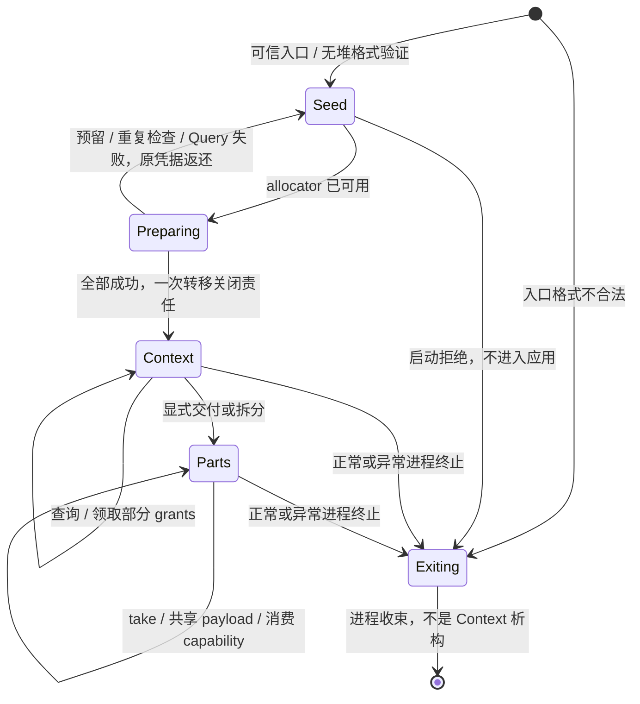

# 现有用户态分层纠正：libkernel、libprocess、libthread 与 libruntime

> 状态：基线 66f4e9c 的原轮施工曾记录完成；第二轮复核正在修正线程 owner 仲裁、启动采用和入口/Unmap 失败路径。当前交付证据以 [复核报告](review-2026-09-28-runtime-layering.md) 为准，不沿用旧完成声明。

## 交付快照

- `libkernel`、`libthread`、`libruntime` 和 `libprocess::context` 已建立；全部公共库、服务、驱动和验收程序已切换到最终 owner。
- `libruntime::_start` 建立 gp、初始化 heap，以 affine StartupSeed 采用启动 grants，按 EntryThreadDescriptor reservation 登记入口线程，再经内部链接桥以 C ABI 调用 `main(0, null)`；`() / Ok` 走 ThreadExit，Err/panic/OOM 走 ProcessAbort。
- target/linker 已迁到 `user/platforms/`，入口为 `_start`；Base64/D64 release ELF 均通过 OSABI/entry audit 与反汇编门。
- `ThreadRegistry` 以固定槽和预算协作 reap；`ResultReceiver::Drop` 不等待，栈映射在 transient `ObjectBusy` 时让出推进机会；不保留 UserStack abandoned 或 `wait_and_release`。
- 施工期间的重复 raw grant 调用已改为 context owner 的一次转交或 capability 派生；init 的 root Job/SystemReset/MemoryPool 责任由 supervisor 显式持有。

### 入口桥接说明

应用 binary 定义标准 `fn main()`，无需 runtime 入口宏。`libruntime::_start` 经同 crate 内部汇编桥初始化运行环境、采用 StartupContext，再以 C ABI 调用 rustc 生成的 `main(0, null)`；桥符号为内部链接，应用不声明、不命名。

## 两条主线与设计归属

1. 本计划纠正已经实现的用户态结构：抽出 libkernel、建立 libthread、形成中立进程上下文，将 rinlib 的语言环境改名迁至 `user/libraries/libruntime`，分离平台构建资产并接通所有现有消费者。
2. [设备整体设计](todo-2026-09-device-system-design.md) 拥有设备领域、特权资源、驱动/总线/功能协议与真实消费者。两项设计可并行校正；设备资源代码接线以前一条迁移闭包完成为前置。

长期知识由 [framework](../notes/ideas/framework.md)、[task](../notes/ideas/task.md)、[mm](../notes/ideas/mm.md) 分别拥有；当前事实由 [framework impl](../notes/impls/framework.md) 记录。本计划只拥有证据、决定过程、尚需细化的接口、实施顺序和验证。

## 已定方向与本轮修正

runtime 并非不能有依赖，正确约束是通用知识不能反向依赖具体 runtime。用户认可库组合，本轮据此修正上一版“runtime 只指向 libkernel”的过窄图，并将线程从原拟 libprocess 分出独立 libthread。运行角色仍由实际授权与提供的协议决定，不由库名决定。

| 问题 | 已选方案 | 需要保留的边界 |
|---|---|---|
| runtime 身份 | `user/libraries/libruntime`，目录/package/默认 target/crate 同名 | 不保留 rinlib alias/facade |
| runtime 依赖 | libkernel + libprocess 的 context 模块 + libthread | 领域库都可直接复用这些 owner；runtime 不批量重导出类型 |
| 当前身份与管理 | shared 定义 Pid 等 wire 值；libprocess 定义 CurrentProcessInfo/StartupContext 等接口角色 | 启动身份是 provenance，不自动成为内核认证，不产生 ProcessControl |
| 最小 Cargo 图 | libprocess context 默认基础功能；装载/构造/监督用显式 `management` 功能集引入 ELF/libexecution | Cargo feature 合并只能编译更多 API，不自动启动行为或授予权限 |
| 线程 | libthread 拥有 ThreadRegistry（槽、claim、reap、seal）、ThreadRecord、ResultCell、公开 Thread/ResultReceiver；libruntime 只持有 Registry 实例与环境实现 | libthread 不依赖 libprocess/libexecution/runtime；无专职 driver，协作式回收；不公开可绕过 wrapper 的安全离场；入口线程与运行期线程登记后共用状态机，不按 TID/PID 分支 |
| 消息与 signal | Mailbox/Notification/Wait 的基础 API 在 libkernel；RPC 和事件推进各有 owner | 当前 Notification 不是 POSIX handler；默认不建立消息泵、监听线程或 root channel |
| 程序入口 | 标准 `fn main()`；runtime `_start` 接受平台 a0/a1 StartupBlock 参数，内部链接桥显式以 `main(0, null)` 调用 | ELF entry 仍是 `_start`；不再用全局导出桥或入口宏；main ABI 与启动参数 ABI 分离 |
| 启动 context | 无堆 view 校验 → allocator/Registry → once 采用 `EntryThreadDescriptor` 登记入口线程 → 显式交付应用 | 不把 env 全局变量搬家，不把 payload 伪造为无条件 static，不复制 Handle 关闭权；第二次进入 `_start` 为完整性失败 |
| 线程环境与结果 | ThreadCreate 挂起 → 登记 record/ResultCell → ThreadStart；结果由 ResultCell 仲裁 | 不把 DONE 当成 T 已初始化；T/F 只在用户线程 Drop；TLS/unwind/detach 不在范围；具体施工见 [owner 计划](todo-2026-09-14-user-memory-owner-lifecycle.md) |
| shared 与 Rust | 删除 ExitCode、Termination/ProgramResult；shared 定义结构化 `TerminationCause` | main 返回 Err 由 libruntime 转 ProcessAbort；无任何数值退出码 |
| 平台构建 | target JSON/ISA/共同布局到 `user/platforms/`，采用通用入口符号；runtime 提供适配 | 不让替代 runtime 依赖旧 runtime 目录或编译器 main 包装 |
| allocator 与异常 | runtime owns global allocator/panic/OOM/入口 wrapper；libkernel 最小路径无堆 | runtime 依赖库不意味着堆初始化前可调用所有 API；main 返回 Ok 只结束入口线程，进程在末线程离场时 Completed |

自进程线程创建、映射和退出使用内核既有 self 作用域、绑定资源与准入，不新增虚构的操作 capability。通信、跨对象管理等必须有相应 authority；链接库只提供知识，不隐式增加任何权限。

普通程序可能需要某种知识，不等于 runtime 必须拥有其 API 或启动服务。未来若增加停止请求/协作取消等 runtime 事件，必须定义入口 authority、事件协议、普通线程中的处理和收束；它不是把现有 Notification 改名为 signal handler，也不是本轮默认监听机制。

## 当前实现与证据

当前实现已完成本计划的用户态分层闭包。以下事实以源码为准：

| 组件 | 当前 owner | 入口/边界 |
|---|---|---|
| `libkernel` | ecall、错误解码、IPC/MM、Process/Thread 原语、时间和系统控制 | `ThreadControl` 是唯一关闭 owner；无 runtime 初始化 |
| `libprocess::context` | StartupBlock 校验后的身份、payload、descriptor 与初始 capability owner | grants 一次采用；普通 launcher/服务按索引显式转交 |
| `libthread` | ResultCell、ThreadRegistry、ThreadFactory/Prepared、trampoline、协作式 reap | `ResultReceiver::Drop` 不等待；`enter/leave` 在用户线程，`retire` 在 DONE 后执行 |
| `libruntime` | `_start`、gp、heap、panic/OOM、入口线程 adopt、结果收束 | rustc main 经内部汇编桥按 C ABI 接收 argc=0、argv=null；runtime 入口处理返回结果 |
| `user/platforms` | 两种 RV64 target 与共同 linker | `ENTRY(_start)`，不再借 argc/argv，不保留旧 runtime 目录 |

全部公共库、服务、驱动和验收程序已经迁移；`user/rinlib`、旧 alias/facade、`lang_start`、`ENTRY(main)`、旧栈 abandoned 计数与 `wait_and_release` 已删除。

host tests、`just check`、`just clippy`、Base64/D64 release ELF audit/入口反汇编和 `just acceptance` 均通过。普通出生块最终只读映像仍作为范围外后续债务保留，已登记在本记录末尾。

## libkernel 接口与资源契约核对

本轮把公共出口、owner 和失败形状细化到下面的 API 面。长期语义由 [kernel-interface](../notes/ideas/kernel-interface.md) 拥有，具体 Rust 模块组织由源码与实现篇核对。表中保留设计依据和实际 owner；不为尚未设计设备预留调用号。

| 目标模块/出口 | 类型与调用形状 | 资源、失败与停驻 | 当前来源 |
|---|---|---|---|
| 私有 call/backend；窄 raw 边界 | syscall 寄存器/错误解码；必要入口以 unsafe 暴露 | 不分配用户堆；是否 park 由具体调用而非 unsafe 标记决定 | rinlib/call.rs |
| object/capability | `Capability::borrow()`、`description()`、显式 `duplicate(rights)`、`close(self)`；`CapabilityRef<'_>` 只借用 | duplicate 返回新 entry；close 失败返还原 owner；合法非映射 Close 可等待内核退休 | ipc/capability.rs、object.rs |
| role 转换 | `T::try_from(Capability)` 或等价 named adopter；失败包含原 Capability | 先有独占来源证明，再查 role/rights；不能以 Query 创造关闭权，已知不可变描述可以沿 owner 复用 | 现有 sender/mailbox/invitation 等 adopter |
| memory | MemoryPool/MemoryObject、MappedRegion、SharedMemory view；Map/Unmap/Protect/Seal | 无用户堆基础路径；Map/Unmap 可 park；失败返还 region 或相应 owner；不补造 Drop 回收方案 | memory_pool/object、mm、shared_memory |
| process 原语 | JobControl、ProcessControl、ProcessBuilderHandle；Create 返回 builder/control/pid 的一组 owner，Query/Drain 是单步 | Builder 非 Clone，Start 消费它，失败保留；Control close 不代表已 Drain；高层 ProcessBuilder 仍归 libprocess | rinlib/process.rs 的原语部分 |
| Building 资源转交 | `bind_memory(builder, pool)`、`grant(builder, batch)` | Bind 失败返还 pool；Grant 失败返还批次，成功返回 child-local 数值集合而非本进程 Capability；输出容量预备后提交 | process.rs / libprocess 现有组装 |
| thread 原语 | ThreadControl、ThreadCreate/ThreadStart/ThreadExit/Wait；裸执行地址入口 unsafe | Create 返回挂起线程的 Control，Start 只发布；`ThreadExit()` 无参数且 unsafe，Registry/TLS/栈政策不下沉 | call.rs、thread.rs 的内核操作 |
| ipc/message | Mailbox、MailboxSender、SendOnce、Lifetime/Delivery、Packet、ReceiveBuffer | Send/Receive 非阻塞；失败返还未消费的 packet/sender；接收前预付结果 owner 空间，不在安装后才分配 | ipc/message.rs、packet.rs |
| ipc/notification | 补 NotificationOwner/NotificationSignaler 安全包装，create 原子返回双 owner，take/signal/borrow | owner.take 显式消费位；signaler 不消费；不建异步 handler 或默认频道 | notification.rs 当前 raw-only，新增包装不新增 syscall |
| ipc/tunnel | Endpoint、EndpointCleanup、Invitation、AttachFailure | Endpoint 绝不擦成通用 Capability；映射借用约束关闭；Attach 区分未提交返还与已消费 cleanup | tunnel.rs、invitation.rs |
| wait | WaitMany、WaitSet、观察输入和结果容器 | 输入为借用/观察，不取得关闭权；显式等待；注册持久性不复制业务 owner | wait.rs、wait_set.rs |
| time/system/debug | Deadline/MonotonicNow/SleepUntil、自进程退出、受权 SystemReset、零堆 Debug | 值操作不分配；Sleep 明确等待，Reset 只在拒绝时返回；无服务关机政策 | time.rs、system.rs、dbg.rs |
| startup view | 从可信入口取得的稳定字节视图和无堆格式访问 | 原始指针接管 unsafe；只读视图不授予原始 Handle 采用权；解码兼容现 outer 的非对齐输入 | env.rs 的字节接收 + shared/startup 校验 |

低层 ProcessBuilderHandle 与 libprocess 的 ELF/多步骤 ProcessBuilder 不同，不能通过同名重导出隐藏职责。ProcessControl/ThreadControl 只拥有本地表项；公开 Thread 与 Registry record 共享同一 ThreadControl owner，最后引用 Close。原始数值提取不是复制 authority，所有会消费裸值的安全捷径须删除或变成有前置条件的 unsafe 边界。

统一失败纪律是按操作形状保留责任，不是强制每个 API 都套同一泛型错误：借用操作不消费输入，新建失败不遗留新 owner，消费操作失败返还输入，已提交部分结果显式返回 cleanup。已有的 Invitation/Endpoint 特殊结果保留，不压成单个 SystemCallError。

### 源码核实与必须纠正的前提

- 普通 `libprocess::map_birth_block` 仍使用 READ|WRITE，ThreadCreate 后一次写入；init 的 bootstrap block 则只读。该 mapping 语义属于后续只读映像契约，不阻塞本轮 owner 分层；`task/proc.rs::write_building` 已明确允许不具写权限的最终 PTE。
- 起始地址/字节长不足以重建 MappedRegion 的 reservation/backing owner。本次统一为进程寿命启动映像，不新增 StartupUnmap，也不复制大 initfs。该选择与现有 init payload 保活一致；未来提前释放需独立契约。
- HandleQuery 只读且不转交 owner；role adopter 不能独自防止双重接管。StartupSeed 的一次来源和查询结果必须同时成立。
- 非映射 Capability 与 Endpoint 不可混用；现有 Receive/Packet 的预付容器可以复用其机制思路，但初始 grants 不受消息的固定八个槽限制，不能直接拿消息上限限制 StartupBlock。
- Send/Receive 在 message idea 中明确为业务非阻塞；带 Deadline 不等于等待重试。分配准备、业务等待与内核退休 park 必须分别标注。
## libthread 接口与平台入口核实

线程契约由 [task](../notes/ideas/task.md#用户态线程资源收束) 拥有；类型草案、ResultCell 交错表、内核改动点、施工顺序与验证门由 [用户内存 owner 计划](todo-2026-09-14-user-memory-owner-lifecycle.md) 唯一拥有。本节只保留分层迁移需要的入口事实。

当前实现事实以本轮复核为准：`StartupSeed` 先无堆核验 StartupBlock，采用阶段逐项非对齐读取、预留工作区、Query 全表，全部通过后建立 Capability owner；失败保留 Seed。`ResultReceiver` Drop 只放弃结果；Registry 只登记已启动或已放弃的线程，PreparedThread 放弃关闭唯一 Control 后以普通 record 登记，取消与 reap 无仲裁。

### 入口和 profile 事实门

- RISC-V psABI v1.0 要求程序入口自行初始化 gp，gp/tp 为不可分配寄存器；`riscv-elf.adoc` 要求使用 `.option norelax` 初始化 `__global_pointer$`。当前用户 linker 没有该符号，不能依赖链接器未定义行为。
- psABI 不定义 eRhino 的出生 a0/a1；StartupBlock 约定由平台 `_start` 拥有。
- Base64 为 RV64IMAC/LP64、FS 关闭；D64 为 RV64IMAFDC/LP64D，内核保存 FPR/fcsr。两个入口适配只用共同整数指令。
- ELF admission 拒绝 PT_TLS；本轮不实现 TLS。
- 用户 sp 16 字节对齐；ThreadStartContext 的入口/栈校验仍由内核完成。
- `_start` 返回类型为 never；main 返回 Ok 调用 `ThreadExit()`，Err 调用 `ProcessAbort()`。

实施前在钉住工具链下验证 `.option norelax`、`__global_pointer$`、`Rust main`/宏入口和链接段。平台门：两个 target 检查最终 ELF `_start`、入口线程与运行期 trampoline 首段反汇编、gp 初始化未被 relaxation 删除、a0/a1 未破坏、SP 对齐、Base64 无 FP，旧 ENTRY(main)/lang_start 消失。

规范固定入口：[psABI v1.0 调用约定](../references/normative/riscv-psabi-v1.0/riscv-cc.adoc)、[psABI v1.0 ELF 与 relaxation](../references/normative/riscv-psabi-v1.0/riscv-elf.adoc)。

## libprocess::context 接口契约稿

具体时序与寿命的唯一契约见 [bootstrap 接收章节](../notes/ideas/bootstrap.md#用户态接收与一次性交接)。context 的这些 API 不依赖 management/ELF/libexecution/libthread/runtime；采用阶段需要 alloc，但不安装 allocator。

```rust
// 接口轮廓；不是可编译代码，错误内部字段与实现布局不在这里冻结。
impl StartupSeed {
    pub unsafe fn from_entry(base: *const u8, len: usize)
        -> Result<Self, StartupParseError>;
}
impl StartupContext {
    pub fn adopt(seed: StartupSeed) -> Result<Self, StartupAdoptFailure>;
    pub fn current(&self) -> &CurrentProcessInfo;
    pub fn payload(&self) -> &StartupPayload;
    pub fn grants(&mut self) -> &mut InitialGrants;
    pub fn into_parts(self) -> (CurrentProcessInfo, StartupPayload, InitialGrants);
}
impl CurrentProcessInfo {
    pub fn pid(&self) -> Pid;
    pub fn parent_pid(&self) -> Pid;
}
impl StartupPayload {
    pub fn bytes(&self) -> &[u8];
}
impl InitialGrants {
    pub fn slot(&self, index: usize) -> Result<GrantSlotInfo, GrantIndexError>;
    pub fn take(&mut self, index: usize) -> Result<Capability, GrantTakeError>;
    pub fn close_remaining(self) -> Result<(), GrantsCloseFailure>;
}
```

| 类型/结果 | 精确责任 | 复制与线程条件 |
|---|---|---|
| StartupSeed | libprocess context 拥有的入口接收凭据；内部借助 libkernel 稳定 view；尚未有 typed owner 的初始表项全部由它承接 | 非 Clone；唯一入口跨 unsafe 构造。正常新线程不得再次构造；raw 指针可读/稳定/独占采用是 SAFETY 前提 |
| StartupAdoptFailure | 错误原因、必要的槽位定位、完整原 Seed；没有部分 Capability 被创建或关闭 | 预留失败可重试；格式、重复/无效 handle、未知或不支持 role、Query 错误不能跳过进入应用 |
| CurrentProcessInfo | private 构造，保存已交付 provenance；PID/parent PID accessor 不请求管理权 | Copy/Clone；不提供从任意 parsed bytes 到此来源视图的安全构造器，仍非认证身份 |
| StartupPayload | 持有进程寿命只读映像的 view 凭据；不拥有 unmap 或原始 Handle 数组 | Clone + Send/Sync 以稳定映像不变量为 SAFETY 依据；bytes 的借用不越过视图借用，不输出 static slice |
| InitialGrants | 一组已采用非映射 Capability，每槽独占，缺失槽不可恢复成原 owner | 非 Clone；Send，非 Sync，跨线程 move 或应用显式加锁；无 raw 数组全局 getter |
| GrantSlotInfo | Available 的不可变 entry 描述或 Taken；越界独立返回错误 | 描述可复制但不是关闭/转交权，不缓存动态 signals |
| GrantTakeError | IndexOutOfRange / AlreadyTaken 等不消费结果 | 保留容器和其它所有槽；成功后 typed 转换失败由调用者持有返还 Capability，不隐式放回槽 |
| GrantsCloseFailure | 未关闭的剩余 InitialGrants 与具体失败位置/原因 | 已成功关闭的槽保持 Taken，不重复关闭；残余显式可继续处理 |

from_entry 先作不分配的 outer 校验；失败时没有安全 adopted owner，runtime 按早期失败路径退出，不能猜测 raw Handle 做 Drop。字节可读与稳定是原始边界的前置，格式校验不验证任意指针的可访问性。shared 解码允许非对齐输入，采用侧应按值解码 Handle，不能未经对齐检查构造 typed Handle slice。

adopt 顺序：预付全部 slots/验证工作区 → 拒绝重复 Handle 数值 → Query 每个 entry 并核实安全可采用的非映射 role → 一次消费 Seed → 无分配/无失败地安装所有 owner 和 Context。kind/role/rights 的已核实不可变描述随 owner 复用；两个不同 Handle 对应同一 object_id 合法。Seed 移交关闭责任由 libprocess 的局部 unsafe adopter 完成，论证同时引用来源唯一性和 Query；不让 libkernel 反向依赖 StartupContext。

采用前 role 集合以当前 ABI 完整矩阵核对：内核可 GRANT 的 Mailbox/Notification owner、sender/signaler、MemoryObject/Pool、Job/Process/Thread 控制、ProcessBuilder、Invitation、Lifetime/Delivery、WaitSet/SystemReset 都不能因“不是普通 sender”被遗漏；本地 mapping-bound Endpoint 拒绝。最终 rights 可能已去除 GRANT/TRANSIT，不据此拒收。后续新增 role 必须同步 adopter 与验证，不将未知 role 当叶子猜测关闭。

Context 不主动创建 mailbox、notification、thread 或 self ProcessControl；空程序可有零 grants。初始四项 primordial graph 仍由 shared/startup::initial 与 init 解释，普通 context 不预置这些索引的业务含义。

### 采用状态与提交点



这不是内核事务或新增 ABI 状态；采用提交是用户侧 owner 建立点。初始 entry 在进入 runtime 前早已存在，不在 adopt 时重新铸造。若 runtime 早期退出，实际 HandleTable、堆 arena 和地址空间由既有进程收束负责；不调用尚未建立的服务或用 PID 选择特殊特权退出。

### 消费者与失败走查（设计证据）

| 场景 | 沿契约应出现的行为 | 是否影响接口 |
|---|---|---|
| 普通空程序 | 零 grants、空 payload 合法；不创建监听器或线程；context 不拉入 management | 本轮 context 基础接口覆盖 |
| init 与大 initfs | payload 保持原映射，不复制进堆；四个初始角色按索引 take 一次，之后子进程装载持 payload view | 需要 StartupPayload Clone/进程寿命，而非普通 MappedRegion Drop |
| 创建子进程 | builder 从显式 CurrentProcessInfo 取 provenance；Grant 成功的 child-local 数值进入只读出生块，Start 之后 receiver 采用 | 调整 launcher 权限与调用签名，不新增内核 ABI |
| 带 RPC 的服务 | take Mailbox/相关能力，role 转换成功后构造 librpc 对象；转换失败仍有原 Capability；剩余 grants 可显式关闭 | 不创建第二套 startup/RPC 运输类型 |
| 重复 Handle / 无效 role | 在提交前拒绝，尚未生成双 owner；不误判同 object 的两个不同 entry；Endpoint 不转为通用 owner | 需错误可定位并返还 Seed |
| 元数据预留失败 | 不关闭初始能力，不调用应用；可重试或进程失败收束 | 与 allocator 无堆准备分离 |
| 跨线程读取 payload | 移交或 clone 只读视图，grant bank 仍单一 owner；dropping context 不使 payload 悬垂 | 无强制复制/Arc 回收或隐式全局 env |
| Map/Close 期间线程终止 | 已提交内核责任不取消；调用帧/结果义务直到离场屏障，startup/adopter 不伪造成功 | libkernel 与 libthread 完成形态已落地；验证证据见当前实现与证据节 |

本节原为施工前草案；与当前代码及契约不一致的实现描述，以本轮复核报告和对应 ideas/impls 为准，不作为当前完成证据。

## 实施顺序与完成状态

基线 66f4e9c 曾将第一主线记录为迁移闭包完成。本轮复核发现线程取消仲裁、StartupSeed 全表核验/原凭据失败保留、入口桥与 Unmap owner 缺口，原完成声明撤回。第二轮处置、证据和未闭合项由唯一复核报告拥有。

改名同步面和既有迁移结论仍按当时提交记录追溯；不得将历史成功的构建或测试挪作本轮证据。

改名同步面：workspace/manifests/Cargo.lock、.cargo config、两种 target、linker/入口、Justfile host 清单及 FP 路径、编译失败示例、所有导入、编辑器词表、当前文档。历史固定提交记录保留 rinlib。ELF 工具当前不识别 runtime 名，继续依据 ET_EXEC、入口范围与执行 profile 验证。

不新增第二个 runtime、通用 std facade、TLS、unwind、detach、自动消息泵或专职 cleanup driver；线程回收为协作式，契约见 [task](../notes/ideas/task.md#离场与-cleanup)。

## 与其它专题的接点

- 设备设计继续使用正确分层；runtime 可组合线程/上下文不会使 libdriver/libdevice 反向依赖 runtime，也不改变它们的授权来源。
- [用户映射 owner](todo-2026-09-14-user-memory-owner-lifecycle.md) 的线程子集已作为本次分层硬前置完成，独占 ThreadCreate/ThreadStart、TerminationCause、Registry/ResultCell 的施工方案与验证门；其它 allocator/映射扩展仍按独立需求。
- 保留区、IRQ、内核预算、关机等原计划仍各自拥有领域功能。本主线不以 ProcessTerminate 冒充其正常收束。

## 施工与交付门

本轮交付门尚未通过：线程 owner、出生、结果、回收、启动采用与真实消费者责任链必须按复核报告完成；不以基线迁移完成或旧验收结果代替。

实施门：

- runtime → context/thread/kernel 单向成立；没有领域库反向依赖 runtime，没有私有 env、默认 authority 或全局 hook。
- libprocess context 可独立于 management 编译；feature 合并不改变 runtime 启动行为。libthread 与 libexecution、libprocess 管理层无环。
- StartupContext 的身份、payload 和 capability 责任分开；Seed 独占采用、重复/再次领取被拒绝；启动映像统一只读并由地址空间保活至进程结束，来源说明不冒充内核认证。
- 栈/结果/环境/Control 到 DONE 及 Map 义务解除后才可回收，失败保留 owner；不对未初始化结果执行读取或 Drop。
- allocator 最小路径无递归分配；main/线程返回、panic/OOM、ProcessTerminate/ProcessAbort 与上级 Drain 各有明确边界，无数值退出码残留。
- rustc main 与 runtime bridge 与 `_start` 满足平台 ABI；无旧 lang_start 借位/ENTRY(main) 路径，内核不依赖用户 runtime。
- 按构建手册完成依赖/feature/符号、host/compile-fail、两种用户 target 与内核入口、真实启动和退出及完整 acceptance；不临时造替代 runtime 验收体。
- 旧代码路径和配置已删除，当前 impls 与真实源码一致，历史证据保持原事实。

## 跨会话接力断点

### 工作树与授权

- 当前分支 `master`，本次分层迁移仍未 commit/push；工作树保留本闭包的代码与同步文档改动。
- 基线 66f4e9c 及此前工作记录仅作为既有实现背景；本轮纠正的 P1、失败路径和接力状态由唯一 [复核报告](review-2026-09-28-runtime-layering.md) 拥有。
- `plans/archived/todo-2026-09-device-architecture.md` 只表示初始概念稿完成，不代表设备详细设计完成。

### 已确定，不重复选方案

| 内容 | 当前结论与归属 |
|---|---|
| 两条主线 | 先纠正既有用户态结构，再实施设备模型；两项设计可并行，代码接线有前置。设备记录独立拥有 D0—D6 |
| 库组合 | libkernel 资源契约、libprocess context/management、独立 libthread、libruntime 程序环境；runtime 可单向组合知识库，库不反向依赖 runtime |
| 改名与构建 | runtime 已迁到 `libraries/libruntime`，不留 alias/facade；target/共同布局位于 `user/platforms` | 已完成 |
| 资源接口 | kernel-interface idea 与本计划 API 表已确定 value/borrow/owner、消费失败返还、分配/等待/退休区别；实现与消费者验证已完成 | 已完成 |
| 启动 | StartupSeed 一次来源与 role 核实分开；采用结果把入口 descriptor 与 Control 直接交 runtime，StartupContext 消费式分离身份/payload/affine grants；出生块统一只读 | 整体收敛轮 check/clippy/host 与全 acceptance 通过，见 review 报告收敛节 |
| 线程 | libthread 拥有 Registry/ThreadRecord/ResultCell/Thread/ResultReceiver；libruntime 只持实例与环境；Create→Start 两段出生；无专职 driver，协作回收；无退出码 |
| 平台入口 | rustc main 与 runtime bridge/_start，入口线程适配与运行期 trampoline 均准备 gp、保持参数/SP；内核拥有 FP gate，当前无 TLS | Base64/D64 镜像与反汇编门已通过 |
| 现有基座 | libexecution 已有 task/source 准入、失败保留/退避与注销/停止；FAL 和 init 已有正式退休/监督消费者。不能重新把整套基座列为缺失 |
| 系统定位 | 不以 POSIX 兼容为目标；多用户非刚需，未来政策归用户态；本轮不建设 TLS/unwind/自动消息泵/第二 runtime |

### 收口与后续边界

1. 本轮线程 owner、出生、结果、回收与启动采用代码迁移及最终门已通过；F3/F5 证据缺口由本报告继续拥有，未写整体完成声明。
2. context、消费者、Cargo 迁移及平台入口的第四轮状态以本报告 F1–F7 处置记录为准；不得沿用第三轮完成声明。
3. 整体收敛轮 `just check`、`just clippy`、host 测试与 `just acceptance` 全路线通过（`artifacts/dev/round5-*`）；F5 因所涉代码已替换按过期关闭。

### 设计阶段与施工阶段裁决（2026-09）

下列事项不会等施工“自然长出来”。凡是决定 owner、失败返还、依赖方向、ABI 或入口契约的内容，先在设计阶段固定；施工阶段只落字段、文件和机械迁移。

| 事项 | 阶段裁决 | 当前方案 |
|---|---|---|
| ThreadRecord / Registry | 设计阶段（已定） | 见 owner 计划；record 只含栈、环境残余、Control 引用与 cleanup 进度；T/F 不进入 record |
| Registry 容量 | 施工阶段定限额 | 由 runtime 装配者按资源模型给出，prepare 前先 reap |
| Cargo 依赖图 | 设计阶段 | `libkernel` 不依赖上层；`libprocess::context` 只依赖 libkernel/shared；`libthread` 不依赖 libprocess/libexecution/runtime；libruntime 只组合 context、thread 与 kernel | 已完成并由 workspace check 验证 |
| rinlib 模块归属 | 设计阶段 | call/ipc/mm/memory/time/system/debug → libkernel；process 原语 → libkernel，context/management → libprocess；thread → libthread；env/startup → libprocess::context；rt/allocator/panic/entry → libruntime |
| 平台入口 | 设计阶段固定协议，施工阶段取证 | 平台 `_start` 先初始化 gp，再把 a0/a1 交给 libruntime；应用使用普通 `fn main()`，runtime `start` lang item 接入；不保留 `entry!`、ENTRY(main) 或 argc/argv 借位 | 已实现，待第三轮完整门复核 |
| 消费者迁移 | 设计阶段固定责任矩阵，施工阶段逐 crate 修改 | 全部公共库、服务、驱动和验收程序已迁移；不保留旧 runtime facade/alias | 已完成 |
| Rust 字段、模块文件、helper、默认容量 | 施工阶段 | 只要不改变上述契约，可由实现按代码结构决定；容量数值由真实装配者和资源模型给出，不能写无依据的全局常量 |
| 编译错误、import、target 路径、linker 段 | 施工阶段 | 按依赖顺序修正并保留编译/ELF/反汇编证据，不提前在设计文档穷举 |

#### 施工时的固定依赖顺序

```text
1. libkernel：迁移 raw call、typed owner、NotificationSignaler、memory/process/thread 原语
2. libprocess::context：StartupSeed/Context/InitialGrants，独立于 management
3. libthread：ThreadEnvironment、ThreadFactory、ThreadRegistry/ThreadRecord、ResultCell、Thread/ResultReceiver、内部 trampoline
4. libprocess::management、librpc/librunnel/libfal/libfs/libservice 及服务消费者
5. libruntime/platforms：`_start`、gp、heap、panic/OOM、`start` lang item、入口线程与结果收束（Ok→ThreadExit，Err→ProcessAbort）
6. 删除旧 runtime 目录、旧 target/linker/import/re-export，执行完整验证
6. 删除 rinlib、旧 target/linker/import/re-export，执行完整验证
```

#### Kernel 与 shared 的施工边界

kernel/shared 的同步改动（ThreadCreate/ThreadStart、ProcessBindExecution、TerminationCause、删除 ExitCode/ProcessExit/ProcessAttach/ThreadSpawn、挂起线程离场发布 DONE）已由[归档生命周期记录](archived/todo-2026-09-28-lifecycle-convergence.md)完成。范围外后续：普通出生块最终只读，复用 `write_building`；`os/kernel/src/rt.rs` 删除未消费的 `Termination` 约束。
设备 D1 的对象关系与 authority 可并行设计，入口见 [设备接力](todo-2026-09-device-system-design.md#当前进度与接力)；不要因本计划推进而登记设备 API、MMIO/IRQ/DMA 或驱动已完成。

### 取证与验证状态

后续每块设计同时核对 ideas、impls、实际导出/调用者与已有测试语义；代码若超前补齐描述，代码与目标不符则记录真实差距，不默认任一侧正确。本轮已核实 Runtime/WorkQueue/Wake、FAL NodeStore/Retirement、Process Collector/Observation、init RootSupervisor；详细路径和复用边界在用户内存 owner 记录，不需要重复整仓盘点。只有源码变化或具体新问题才重取相关证据。

本计划的代码迁移、接口接线与第三轮复核已完成；普通出生块最终只读映像与 `os/kernel/src/rt.rs` 未消费的 `Termination` 约束是已登记的后续项，不阻塞本轮 R1–R9。最终证据见 [第三轮复核报告](review-2026-09-28-runtime-layering.md)。

交付前检查：`git diff --check`、`just check`、`just clippy`、两种用户 target 构建/ELF audit/入口反汇编与 `just acceptance` 均已通过；日志路径与失败现场见复核报告。
